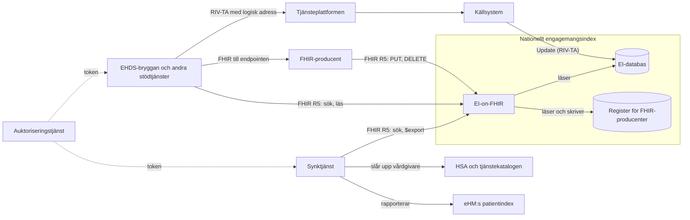
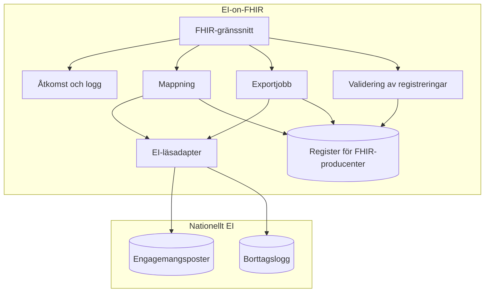
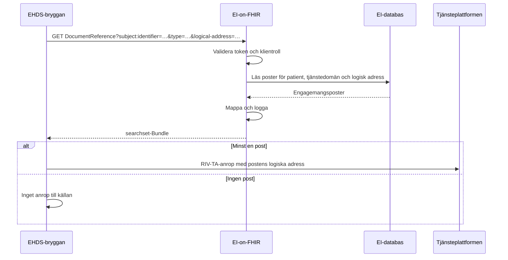
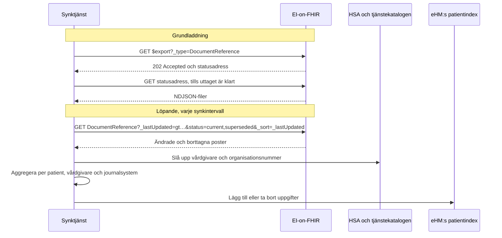
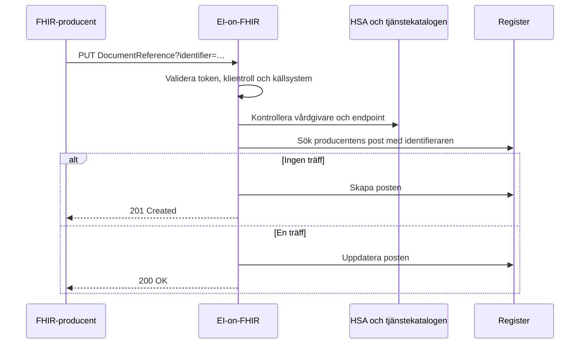

# SAD: EI-on-FHIR

Utkast 0.1 · 2026-11-13

EI-on-FHIR är ett FHIR R5-API ovanpå det nationella engagemangsindexet (EI). Det har tre användningsfall: Ineras interna stödtjänster ska kunna hitta var information finns, en synktjänst ska kunna fylla eHM:s patientindex utifrån befintlig data, och källor som implementerar en tjänsts FHIR-IG i stället för tjänstekontraktet, till exempel för Fasta kontakter, ska kunna registrera sina engagemang så att de syns på samma sätt. Förebilden är NHS Englands National Record Locator (NRL). Den formella specifikationen är [IG:n](../input/pagecontent/index.md) i samma repo.

## 1. Omfattning

| Ingår | Ingår inte |
|---|---|
| Läsning, sökning och massuttag av engagemangsposter via FHIR R5 | Ändringar i hur källor som implementerar tjänstekontrakten registrerar (Update, ProcessNotification) |
| Användningsfall 1: interna stödtjänster, till exempel EHDS-bryggan | Prenumerationer och notiser |
| Användningsfall 2: källa för synk till eHM:s patientindex | Åtkomst för vårdpersonal och invånare, till exempel via NPÖ eller 1177 |
| Användningsfall 3: ett eget register där FHIR-producenter registrerar engagemang | eHM:s API för patientindexet |
| Synktjänsten som konsument av API:et | |

Den tidigare, bredare visionen för ett FHIR-baserat index, med flera försörjningssätt, åtkomstkontroll per användare och juridiska frågor, finns kvar på branchen [`arkiv/fhir-ei-vision`](https://github.com/Inera-AB/EI-on-FHIR/tree/arkiv/fhir-ei-vision) och ligger utanför den här lösningen.

## 2. Krav

### Funktionella krav

| Id | Krav | Användningsfall |
|---|---|---|
| F1 | En stödtjänst kan söka en patients poster, avgränsat till tjänstedomän och logisk adress | 1 |
| F2 | En klient kan läsa en enskild post | 1, 2 |
| F3 | Synktjänsten kan ta ut alla poster i ett massuttag | 2 |
| F4 | Synktjänsten kan hämta alla poster som ändrats eller tagits bort sedan en tidpunkt | 2 |
| F5 | Varje post innehåller det som behövs för att anropa källan: tjänstedomän och logisk adress | 1 |
| F6 | Varje post innehåller det som behövs för patientindexet: patient, källsystem och personuppgiftsansvarig | 2 |
| F7 | En FHIR-producent kan registrera, uppdatera och ta bort sina egna poster | 3 |
| F8 | Poster från EI och från registret kommer i samma sökresultat och massuttag | 1, 2, 3 |
| F9 | Varje post anger hur informationen hämtas: med RIV-TA och logisk adress, eller med FHIR och endpoint | 1, 3 |

### Kvalitetskrav

| Egenskap | Krav |
|---|---|
| Svarstid, användningsfall 1 | En sökning ska inte märkbart förlänga stödtjänstens anrop. Målvärde fastställs med EHDS-bryggan |
| Aktualitet, användningsfall 2 | En ändring i EI ska nå synktjänsten inom ett synkintervall. Intervallet fastställs med eHM |
| Tillgänglighet | Minst som EI:s FindContent |
| Last på EI | API:et får inte påverka EI:s förmåga att ta emot Update och svara på FindContent |
| Säkerhet | Bara registrerade systemklienter. Varje anrop loggas |
| Förvaltningsbarhet | Ingen ny kopia av indexet att hålla i synk |

## 3. Förutsättningar och begränsningar

- EI är källan och förändras så lite som möjligt. Källsystemen registrerar som i dag.
- Informationen i EI används i dag bara för att hitta vart ett anrop ska gå, och EI prövar inte spärr. Användningsfall 1 håller sig inom det. Användningsfall 2 är ett nytt ändamål och förutsätter vårdgivarnas uppdrag.
- Tjänstekatalogen och övriga delar av samverkansinfrastrukturen använder FHIR R5. EHDS-bryggan exponerar FHIR R4 mot sina konsumenter, men är klient mot EI-on-FHIR och läser då R5.
- eHM:s patientindex innehåller patient, vårdgivarens organisationsnummer, journalsystem och kontaktuppgifter enligt promemorian S2026/01360. API:et för det är inte specificerat än.
- EI:s fält dataController är ofta vårdgivarens HSA-id, men kan sedan 2015 vara källsystemets.
- För vissa tjänster, till exempel Fasta kontakter, kan en vårdgivare välja att implementera tjänstens FHIR-IG i stället för tjänstekontraktet. En sådan källa registrerar inte i EI, och en vårdgivare kan ha källor av båda slagen.

## 4. Systemkontext

| System | Roll |
|---|---|
| Källsystem | Implementerar tjänstekontraktet och registrerar engagemangsposter i EI med Update, som i dag |
| FHIR-producent | Implementerar en tjänsts FHIR-IG och registrerar sina poster i EI-on-FHIR:s register |
| Nationellt engagemangsindex | Källan för poster från källsystem som implementerar tjänstekontrakten. EI-on-FHIR är ett nytt gränssnitt i det |
| EHDS-bryggan och andra stödtjänster | Söker poster för en patient, inom användningsfall 1, och hämtar med RIV-TA eller FHIR enligt posten |
| Synktjänst | Läser alla poster och ändringar och fyller eHM:s patientindex, inom användningsfall 2 |
| HSA och tjänstekatalogen | Ger vårdgivare och organisationsnummer för HSA-id, och vårdgivarnas FHIR-endpoints |
| eHM:s patientindex | Tar emot uppgifter från synktjänsten |
| Auktoriseringstjänst | Utfärdar token till systemklienterna |

## 5. Lösningsstrategi

- **Ett läsgränssnitt i det nationella EI, inte en ny tjänst med egen kopia.** API:et läser EI:s data direkt. Det finns då inget nytt register att hålla i synk, och lagringen sker där EI redan får lagra (beslut D2).
- **En pekare per post, som i NRL.** Varje engagemangspost blir en `DocumentReference` enligt profilen Engagemangspost, utan att poster slås ihop (D3).
- **Sökning på patient och typ, som i NRL.** Klienten söker med `subject:identifier` och `type`, och med `logical-address` när den vill avgränsa till en vårdgivare.
- **Standarder för synk.** Massuttag med Bulk Data `$export` och ändringar med `_lastUpdated`, utan egna operationer (D7).
- **Borttag syns.** Borttagna poster visas med status `superseded` under en lagringstid, så att synken kan ta bort uppgifter i patientindexet (D4).
- **Eget register för FHIR-producenter.** En källa som implementerar en tjänsts FHIR-IG registrerar i EI-on-FHIR, inte i EI. Läsningen visar posterna från EI och registret tillsammans (D10).
- **Posten säger hur den hämtas.** `content.profile` anger `riv-ta` eller `fhir`. En källa med båda gränssnitten har två poster, som konsumenten väljer mellan på patient, tjänstedomän och logisk adress (D11, D12).

Från NRL tar lösningen pekaren som `DocumentReference`, sökningen på patientens identitet och informationens typ, att indexet inte bär innehåll, och att klienter är system med behörighet per organisation. Registret för FHIR-producenter följer NRL:s producent-API, med villkorad update och delete. Källor som implementerar tjänstekontrakten registrerar däremot som i dag i EI, och deras poster pekar ut innehållet med logisk adress via tjänsteplattformen, inte med en URL.

## 6. Byggblock

| Byggblock | Ansvar |
|---|---|
| FHIR-gränssnitt | Sökning, läsning, paginering, `$export` och CapabilityStatement. Till exempel med HAPI FHIR, som EHDS-bryggan |
| Åtkomst och logg | Validerar token, avgör klientroll och loggar varje anrop |
| Mappning | Gör om en EI-post till en Engagemangspost: OID till URI, tidsstämplar med tidszon, stabilt id ur EI:s nyckel |
| EI-läsadapter | Frågar EI:s databas eller en läsreplika. Sökningarna motsvarar FindContent, plus sökning på uppdateringstid |
| Exportjobb | Kör massuttag asynkront och skriver NDJSON-filer som klienten hämtar |
| Borttagslogg | Nytt i EI: sparar varje borttagen post med tidpunkt och rensar efter lagringstiden |
| Register för FHIR-producenter | EI-on-FHIR:s eget datalager för poster från FHIR-producenter, med samma borttagslogg. Sökningar och massuttag läser registret och EI tillsammans |
| Validering av registreringar | Kontrollerar att posten följer profilen, att källsystemet är klientens eget, att `custodian` är en vårdgivare och att endpointen finns i tjänstekatalogen |

Synktjänsten är en egen komponent med fyra delar: en läsare som håller reda på senaste `_lastUpdated`, ett uppslag av vårdgivare och organisationsnummer, en aggregering per patient, vårdgivare och journalsystem med eget tillstånd, och en klient mot eHM:s patientindex. Den behöver bara spara postens id, kombinationen och status.

## 7. Körtidsvy

### Användningsfall 1: EHDS-bryggan kontrollerar att det finns information

### Användningsfall 2: synk till eHM:s patientindex

En post vars vårdgivare inte går att bestämma rapporteras inte, utan läggs i en kö för manuell hantering. Med längre intervall jämför synktjänsten ett fullständigt uttag med patientindexet.

### Användningsfall 3: en FHIR-producent registrerar ett engagemang

När en stödtjänst sedan söker patientens poster kommer FHIR-posten med tillsammans med posterna från EI. Har samma källa också en RIV-TA-post för samma patient, tjänstedomän och logiska adress väljer en stödtjänst som kan FHIR FHIR-posten och hoppar över RIV-TA-anropet.

## 8. Driftsättning

EI-on-FHIR driftas tillsammans med det nationella EI, nära dess databas, och exponeras bara internt via samverkansinfrastrukturens API-gateway. Registret för FHIR-producenter är en egen databas i samma miljö. Massuttag körs mot en läsreplika om en sådan finns, så att de inte belastar EI:s skrivningar. Synktjänsten driftas för sig.

## 9. Tvärgående aspekter

| Aspekt | Lösning |
|---|---|
| Autentisering | SMART Backend Services. Klienterna är registrerade system |
| Behörighet | Tre klientroller. En stödtjänst får läsa och söka med patient; en synktjänst får dessutom söka utan patient och göra massuttag; en producent får bara skriva och ta bort sina egna poster i registret |
| Spärr | Prövas inte i API:t, som i dagens EI. Stödtjänsten prövar när den lämnar ut journalinformation |
| Loggning | Varje anrop loggas med klient, tidpunkt, interaktion, parametrar och antal poster. Massuttag loggas per uttag |
| Identifierare | HSA-id anges med `urn:oid:1.2.752.29.4.19`, personnummer och samordningsnummer med HL7 Swedens URI:er. API:et tar emot RIV-TA:s OID:er i sökningar |
| Tid | EI:s tidsstämplar tolkas som svensk tid och anges med tidszon |
| Fel | `OperationOutcome` med statuskod. `503` när EI inte svarar |
| Kapacitet | Paginering med `_count`. Gräns för anrop per klient, med `429` |

## 10. Arkitekturbeslut

| Id | Beslut | Alternativ | Skäl |
|---|---|---|---|
| D1 | FHIR R5 (5.0.0) | R4, som NRL, EHDS-bryggan och HL7 Swedens basprofiler | Tjänstekatalogen och övriga delar av samverkansinfrastrukturen är R5. Bulk Data Access finns bara publicerad för R4, så kravet på `$export` står i text. R5 ger också inbyggda prenumerationer, om de behövs senare |
| D2 | API:et läser EI:s databas eller en läsreplika, som ett nytt gränssnitt i det nationella EI | Anropa FindContent per sökning; egen kopia fylld via ProcessNotification | FindContent kräver patient och kan inte ge ändringar, så användningsfall 2 blir omöjligt. En egen kopia blir ett nytt register att förvalta, och mottagare av notiser får i dag inte lagra posterna |
| D3 | En resurs per EI-post, ingen sammanslagning | En resurs per patient, källa och tjänstedomän | Enkel och trogen mappning. Den som behöver sammanslagning, som synken, gör den själv |
| D4 | Borttagna poster visas som `superseded` från en borttagslogg med lagringstid | Bara fullständig avstämning; borttag via egen notismottagare | Synken behöver se borttag snabbt för att kunna ta bort uppgifter i patientindexet |
| D5 | Poster från EI är skrivskyddade via API:et | Registrering i EI via FHIR | Inga ändringar för källor som implementerar tjänstekontrakten, och EI behöver inget nytt skrivgränssnitt |
| D6 | Ingen spärrprövning i API:t | Prövning per anrop | Klienterna är tekniska stödtjänster utan användare. Prövningen görs när journalinformation lämnas ut, som i dag |
| D7 | Synk med `_lastUpdated` och Bulk Data, utan prenumerationer | Prenumerationer enligt Subscriptions Backport | Enklast, och samma mönster som NRL. Prenumerationer kan läggas till senare |
| D8 | Synktjänsten är en egen komponent | Inbyggd i API:t | API:et blir oberoende av eHM:s API, och synken kan ändras eller bytas utan att API:et påverkas |
| D9 | SMART Backend Services med tre klientroller | Bara klientcertifikat | Samma mönster som EHDS-bryggan, och behörigheter kan uttryckas per klient |
| D10 | FHIR-producenter registrerar i ett eget register i EI-on-FHIR | Översätta FHIR-registreringar till Update i EI | En post i EI ska gå att anropa med RIV-TA, och en källa som bara har FHIR kan inte det. Registret kräver ingen ändring i EI |
| D11 | Hämtningsprotokollet anges i `content.profile` som Coding, med `fhir` och endpointens URL för FHIR-poster | En egen extension; skilda profiler för RIV-TA och FHIR | Standardelement med standardsökparameter (`format-code`), och en profil för båda |
| D12 | En källa med båda gränssnitten har två poster, som inte slås ihop. De matchas på patient, tjänstedomän och logisk adress | Slå ihop till en resurs med två `content` | Ingen samordning mellan EI och registret vid skrivning, och samma regel som D3 |

## 11. Risker och öppna frågor

| Risk eller fråga | Konsekvens | Hantering |
|---|---|---|
| EI:s förvaltning kan inte ge läsåtkomst till databasen eller bygga borttagsloggen | D2 och D4 faller | Stäm av tidigt. Reservlösning: egen kopia via ProcessNotification, efter beslut om lagring |
| Massuttag belastar EI | Sämre svarstider för Update och FindContent | Läsreplika, uttag nattetid |
| Poster där dataController är källsystemets HSA-id | Synken kan inte bestämma vårdgivaren för alla poster | Uppslag via logisk adress och register över källsystem, kö för manuell hantering, mät andelen |
| Vårdgivarnas uppdrag för synken saknas | Användningsfall 2 kan inte tas i drift | Uppdraget utreds parallellt |
| eHM:s API är inte specificerat | Synktjänstens klient kan inte byggas färdigt | Bygg läsning och aggregering först |
| Fältlistan och nyckeln i EI är inte avstämda mot TKB:n | Mappningen eller resursens id kan behöva ändras | Stäm av mot TKB:n för `riv:itintegration:engagementindex` |
| En FHIR-producent anger inte samma logiska adress som sin RIV-TA-post | Konsumenter kan inte se att två poster är samma källa, och kan anropa båda | Krav i IG:n; uppföljning av poster i registret utan logisk adress för vårdgivare som också finns i EI |
| En källa som byter till FHIR slutar med Update innan den registrerar i registret | Engagemangen syns inte under bytet | Rutin vid byte: registrera i registret först |
| Vårdgivarnas FHIR-endpoints finns inte i tjänstekatalogen | Registreringar avvisas | Stäm av hur endpoints för tjänster som Fasta kontakter registreras |

Fler öppna frågor finns i IG:n, på sidan Öppna frågor.

## 12. Referenser

- IG:n i detta repo: `input/` och `sushi-config.yaml`
- [EHDS-bryggans IG](https://github.com/Inera-AB/EHDS-brygga), sidan Arkitektur
- NHS England, [National Record Locator](https://digital.nhs.uk/services/national-record-locator)
- [Bulk Data Access](https://hl7.org/fhir/uv/bulkdata/) och [SMART Backend Services](https://hl7.org/fhir/smart-app-launch/backend-services.html)
- Tjänstedomänen `riv:itintegration:engagementindex` och dess TKB
- Promemorian S2026/01360 om eHM:s patientindex
