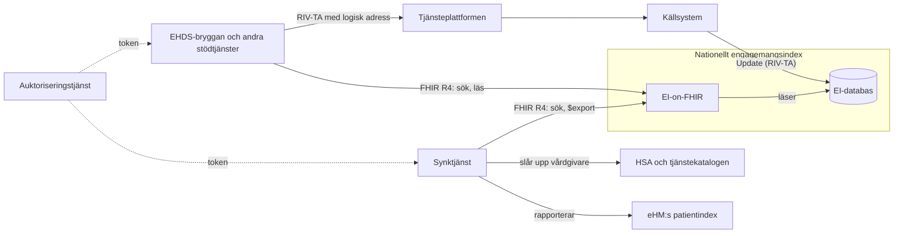
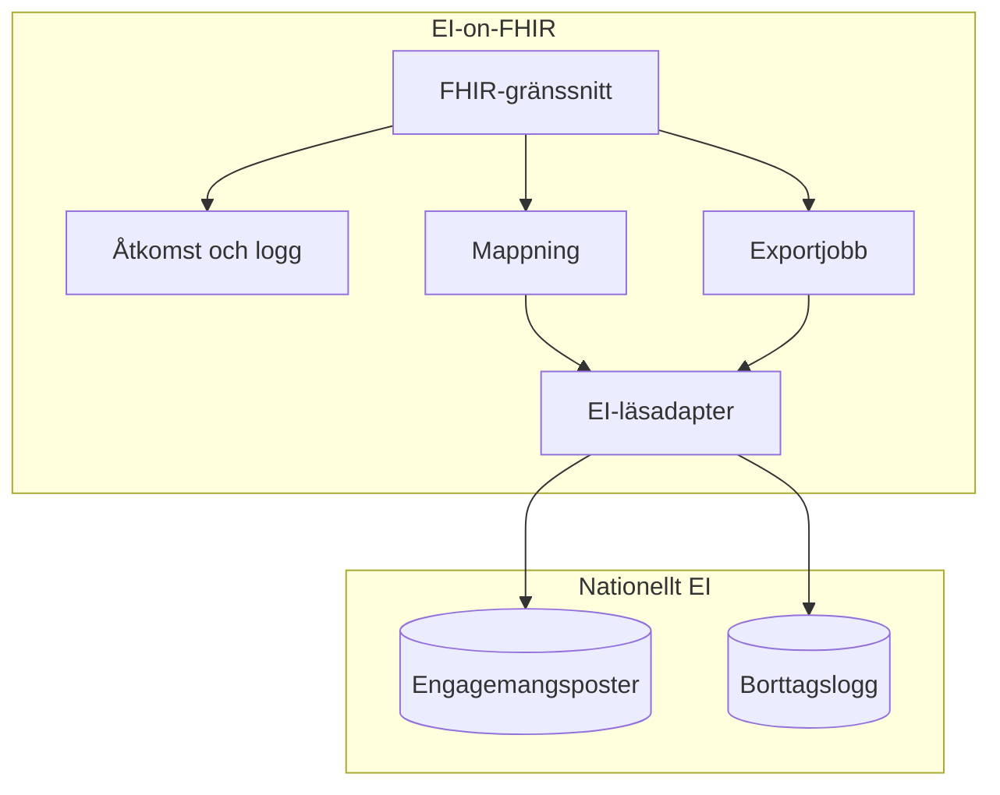
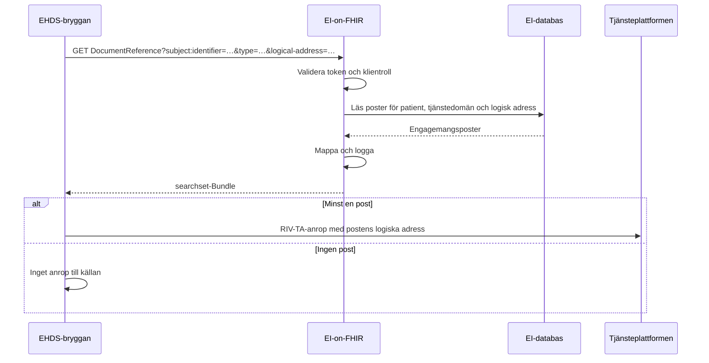
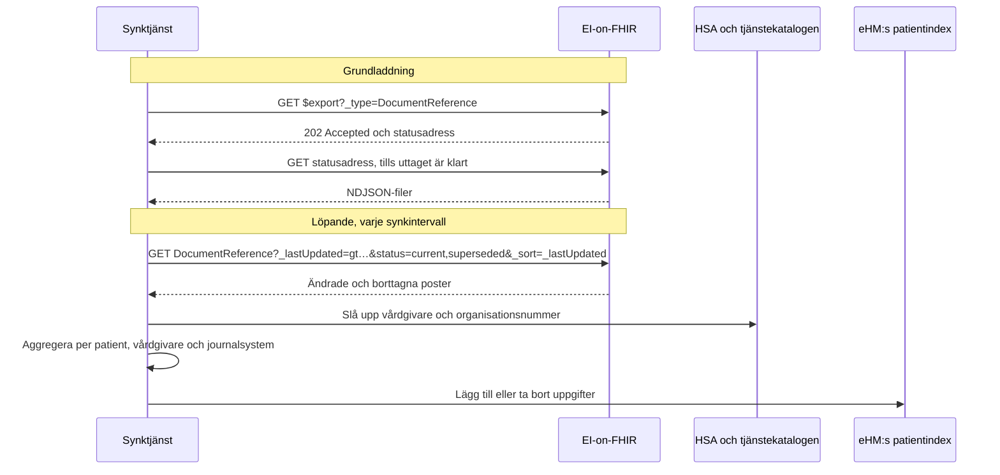

# SAD: EI-on-FHIR

Utkast 0.1 · 2026-11-13

EI-on-FHIR är ett skrivskyddat FHIR R4-API ovanpå det nationella engagemangsindexet (EI). Det har två användningsfall: Ineras interna stödtjänster ska kunna hitta var information finns, och en synktjänst ska kunna fylla eHM:s patientindex utifrån befintlig data i EI. Förebilden är NHS Englands National Record Locator (NRL). Den formella specifikationen är [IG:n](../input/pagecontent/index.md) i samma repo.

## 1. Omfattning

| Ingår | Ingår inte |
|---|---|
| Läsning, sökning och massuttag av EI:s poster via FHIR R4 | Ändringar i hur källsystemen registrerar (Update, ProcessNotification) |
| Användningsfall 1: interna stödtjänster, till exempel EHDS-bryggan | Skrivning via FHIR, prenumerationer och notiser |
| Användningsfall 2: källa för synk till eHM:s patientindex | Åtkomst för vårdpersonal och invånare, till exempel via NPÖ eller 1177 |
| Synktjänsten som konsument av API:et | eHM:s API för patientindexet |

Den bredare visionen för ett FHIR-baserat index, med flera försörjningssätt, åtkomstkontroll per användare och juridiska frågor, finns på huvudbranchen i repot och ligger utanför den här lösningen.

## 2. Krav

### Funktionella krav

| Id | Krav | Användningsfall |
|---|---|---|
| F1 | En stödtjänst kan söka en patients poster, avgränsat till tjänstedomän och logisk adress | 1 |
| F2 | En klient kan läsa en enskild post | 1, 2 |
| F3 | Synktjänsten kan ta ut alla poster i ett massuttag | 2 |
| F4 | Synktjänsten kan hämta alla poster som ändrats eller tagits bort sedan en tidpunkt | 2 |
| F5 | Varje post innehåller det som behövs för att anropa källan: tjänstedomän och logisk adress | 1 |
| F6 | Varje post innehåller det som behövs för patientindexet: patient, källsystem och personuppgiftsansvarig enligt EI | 2 |

### Kvalitetskrav

| Egenskap | Krav |
|---|---|
| Svarstid, användningsfall 1 | En sökning ska inte märkbart förlänga stödtjänstens anrop. Målvärde fastställs med EHDS-bryggan |
| Aktualitet, användningsfall 2 | En ändring i EI ska nå synktjänsten inom ett synkintervall. Intervallet fastställs med eHM |
| Tillgänglighet | Minst som EI:s FindContent |
| Last på EI | API:et får inte påverka EI:s förmåga att ta emot Update och svara på FindContent |
| Säkerhet | Bara registrerade systemklienter. Varje anrop loggas |
| Förvaltningsbarhet | Ingen ny kopia av indexet att hålla i synk |

## 3. Förutsättningar och begränsningar

- EI är källan och förändras så lite som möjligt. Källsystemen registrerar som i dag.
- Informationen i EI används i dag bara för att hitta vart ett anrop ska gå, och EI prövar inte spärr. Användningsfall 1 håller sig inom det. Användningsfall 2 är ett nytt ändamål och förutsätter vårdgivarnas uppdrag.
- EHDS-bryggan och andra stödtjänster i samverkansinfrastrukturen använder FHIR R4 och HL7 Swedens basprofiler.
- eHM:s patientindex innehåller patient, vårdgivarens organisationsnummer, journalsystem och kontaktuppgifter enligt promemorian S2026/01360. API:et för det är inte specificerat än.
- EI:s fält dataController är ofta vårdgivarens HSA-id, men kan sedan 2015 vara källsystemets.

## 4. Systemkontext

| System | Roll |
|---|---|
| Källsystem | Registrerar engagemangsposter i EI med Update, som i dag |
| Nationellt engagemangsindex | Källan för posterna. EI-on-FHIR är ett nytt läsgränssnitt i det |
| EHDS-bryggan och andra stödtjänster | Söker poster för en patient, inom användningsfall 1 |
| Synktjänst | Läser alla poster och ändringar och fyller eHM:s patientindex, inom användningsfall 2 |
| HSA och tjänstekatalogen | Ger vårdgivare och organisationsnummer för HSA-id |
| eHM:s patientindex | Tar emot uppgifter från synktjänsten |
| Auktoriseringstjänst | Utfärdar token till systemklienterna |

## 5. Lösningsstrategi

- **Ett läsgränssnitt i det nationella EI, inte en ny tjänst med egen kopia.** API:et läser EI:s data direkt. Det finns då inget nytt register att hålla i synk, och lagringen sker där EI redan får lagra (beslut D2).
- **En pekare per post, som i NRL.** Varje engagemangspost blir en `DocumentReference` enligt profilen Engagemangspost, utan att poster slås ihop (D3).
- **Sökning på patient och typ, som i NRL.** Klienten söker med `subject:identifier` och `type`, och med `logical-address` när den vill avgränsa till en vårdgivare.
- **Standarder för synk.** Massuttag med Bulk Data `$export` och ändringar med `_lastUpdated`, utan egna operationer (D7).
- **Borttag syns.** Borttagna poster visas med status `superseded` under en lagringstid, så att synken kan ta bort uppgifter i patientindexet (D4).

Från NRL tar lösningen pekaren som `DocumentReference`, sökningen på patientens identitet och informationens typ, att indexet inte bär innehåll, och att klienter är system med behörighet per organisation. Den tar inte NRL:s producent-API, eftersom källsystemen fortsätter registrera med RIV-TA, och den pekar inte ut innehållet med en URL utan med logisk adress via tjänsteplattformen.

## 6. Byggblock

| Byggblock | Ansvar |
|---|---|
| FHIR-gränssnitt | Sökning, läsning, paginering, `$export` och CapabilityStatement. Till exempel med HAPI FHIR, som EHDS-bryggan |
| Åtkomst och logg | Validerar token, avgör klientroll och loggar varje anrop |
| Mappning | Gör om en EI-post till en Engagemangspost: OID till URI, tidsstämplar med tidszon, stabilt id ur EI:s nyckel |
| EI-läsadapter | Frågar EI:s databas eller en läsreplika. Sökningarna motsvarar FindContent, plus sökning på uppdateringstid |
| Exportjobb | Kör massuttag asynkront och skriver NDJSON-filer som klienten hämtar |
| Borttagslogg | Nytt i EI: sparar varje borttagen post med tidpunkt och rensar efter lagringstiden |

Synktjänsten är en egen komponent med fyra delar: en läsare som håller reda på senaste `_lastUpdated`, ett uppslag av vårdgivare och organisationsnummer, en aggregering per patient, vårdgivare och journalsystem med eget tillstånd, och en klient mot eHM:s patientindex. Den behöver bara spara postens id, kombinationen och status.

## 7. Körtidsvy

### Användningsfall 1: EHDS-bryggan kontrollerar att det finns information

### Användningsfall 2: synk till eHM:s patientindex

En post vars vårdgivare inte går att bestämma rapporteras inte, utan läggs i en kö för manuell hantering. Med längre intervall jämför synktjänsten ett fullständigt uttag med patientindexet.

## 8. Driftsättning

EI-on-FHIR driftas tillsammans med det nationella EI, nära dess databas, och exponeras bara internt via samverkansinfrastrukturens API-gateway. Massuttag körs mot en läsreplika om en sådan finns, så att de inte belastar EI:s skrivningar. Synktjänsten driftas för sig.

## 9. Tvärgående aspekter

| Aspekt | Lösning |
|---|---|
| Autentisering | SMART Backend Services. Klienterna är registrerade system |
| Behörighet | Två klientroller. En stödtjänst får läsa och söka med patient; en synktjänst får dessutom söka utan patient och göra massuttag |
| Spärr | Prövas inte i API:t, som i dagens EI. Stödtjänsten prövar när den lämnar ut journalinformation |
| Loggning | Varje anrop loggas med klient, tidpunkt, interaktion, parametrar och antal poster. Massuttag loggas per uttag |
| Identifierare | HSA-id anges med `urn:oid:1.2.752.29.4.19`, personnummer och samordningsnummer med HL7 Swedens URI:er. API:et tar emot RIV-TA:s OID:er i sökningar |
| Tid | EI:s tidsstämplar tolkas som svensk tid och anges med tidszon |
| Fel | `OperationOutcome` med statuskod. `503` när EI inte svarar |
| Kapacitet | Paginering med `_count`. Gräns för anrop per klient, med `429` |

## 10. Arkitekturbeslut

| Id | Beslut | Alternativ | Skäl |
|---|---|---|---|
| D1 | FHIR R4 (4.0.1) | R5, som huvudbranchens vision | NRL, EHDS-bryggan och HL7 Swedens basprofiler är R4, och Bulk Data finns för R4. Prenumerationer i R5 behövs inte |
| D2 | API:et läser EI:s databas eller en läsreplika, som ett nytt gränssnitt i det nationella EI | Anropa FindContent per sökning; egen kopia fylld via ProcessNotification | FindContent kräver patient och kan inte ge ändringar, så användningsfall 2 blir omöjligt. En egen kopia blir ett nytt register att förvalta, och mottagare av notiser får i dag inte lagra posterna |
| D3 | En resurs per EI-post, ingen sammanslagning | En resurs per patient, källa och tjänstedomän | Enkel och trogen mappning. Den som behöver sammanslagning, som synken, gör den själv |
| D4 | Borttagna poster visas som `superseded` från en borttagslogg med lagringstid | Bara fullständig avstämning; borttag via egen notismottagare | Synken behöver se borttag snabbt för att kunna ta bort uppgifter i patientindexet |
| D5 | Skrivskyddat API | Registrering via FHIR | Inga ändringar för källsystemen |
| D6 | Ingen spärrprövning i API:t | Prövning per anrop | Klienterna är tekniska stödtjänster utan användare. Prövningen görs när journalinformation lämnas ut, som i dag |
| D7 | Synk med `_lastUpdated` och Bulk Data, utan prenumerationer | Prenumerationer enligt Subscriptions Backport | Enklast, och samma mönster som NRL. Prenumerationer kan läggas till senare |
| D8 | Synktjänsten är en egen komponent | Inbyggd i API:t | API:et blir oberoende av eHM:s API, och synken kan ändras eller bytas utan att API:et påverkas |
| D9 | SMART Backend Services med två klientroller | Bara klientcertifikat | Samma mönster som EHDS-bryggan, och behörigheter kan uttryckas per klient |

## 11. Risker och öppna frågor

| Risk eller fråga | Konsekvens | Hantering |
|---|---|---|
| EI:s förvaltning kan inte ge läsåtkomst till databasen eller bygga borttagsloggen | D2 och D4 faller | Stäm av tidigt. Reservlösning: egen kopia via ProcessNotification, efter beslut om lagring |
| Massuttag belastar EI | Sämre svarstider för Update och FindContent | Läsreplika, uttag nattetid |
| Poster där dataController är källsystemets HSA-id | Synken kan inte bestämma vårdgivaren för alla poster | Uppslag via logisk adress och register över källsystem, kö för manuell hantering, mät andelen |
| Vårdgivarnas uppdrag för synken saknas | Användningsfall 2 kan inte tas i drift | Uppdraget utreds parallellt |
| eHM:s API är inte specificerat | Synktjänstens klient kan inte byggas färdigt | Bygg läsning och aggregering först |
| Fältlistan och nyckeln i EI är inte avstämda mot TKB:n | Mappningen eller resursens id kan behöva ändras | Stäm av mot TKB:n för `riv:itintegration:engagementindex` |

Fler öppna frågor finns i IG:n, på sidan Öppna frågor.

## 12. Referenser

- IG:n i detta repo: `input/` och `sushi-config.yaml`
- [EHDS-bryggans IG](https://github.com/Inera-AB/EHDS-brygga), sidan Arkitektur
- NHS England, [National Record Locator](https://digital.nhs.uk/services/national-record-locator)
- [Bulk Data Access](https://hl7.org/fhir/uv/bulkdata/) och [SMART Backend Services](https://hl7.org/fhir/smart-app-launch/backend-services.html)
- Tjänstedomänen `riv:itintegration:engagementindex` och dess TKB
- Promemorian S2026/01360 om eHM:s patientindex
