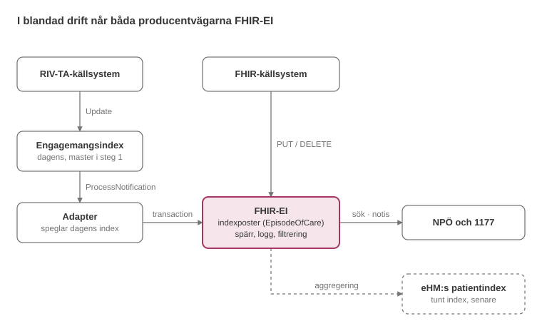

# FHIR-baserad engagemangsindexkomponent – utkast till spec

2026-10-26 · Oskar Thunman

> Arbetsunderlaget som implementationsguiden i detta repo bygger på. Specen beskriver designval och identifierade behov; IG:n under `input/` är den formella realiseringen. IG_n gör några specifika val kring öppna frågor och designval, för att få det att fungera i FHIR. Dessa går att spåra på IG-sidan *Mappning till profiler* (`input/pagecontent/mappings.md`). Designen är tänkt att styras från denna spec och sedan föras in i IG:n.

## Syfte och avgränsning

Specen beskriver en ny EI-liknande komponent inom den nya samverkansinfrastrukturen som ett rikt patientiondex i FHIR (arbetsnamn FHIR-EI). Komponenten svarar på tre frågor: i vilka system finns information om en patient, vilka informationsmängder finns där, och när uppdaterades de senast. Den ersätter engagemangsindex när NPÖ och 1177 FHIR-ifieras, och följer samma mönster som NHS Englands National Record Locator.

Specen omfattar:

- informationsmodell för indexposten
- försörjning av indexet: de sätt en tjänsts indexposter kan fyllas och hållas aktuella
- kodverk för informationsmängder
- API för sökning, registrering och prenumeration
- händelsemodell och leveransgarantier, inklusive övergången från dagens engagemangsindex
- spärr, loggning och filtrering av svar
- samexistens med eHM:s patientindex: borttag, grundladdning och återsynk

Specen är neutral till hur indexet fylls. Konsumenterna läser samma API oavsett om en tjänsts indexposter registreras av producenterna, fylls av Inera utifrån eHM:s patientindex och riktade frågor till källorna, eller speglas från dagens engagemangsindex. Försörjningen väljs per tjänst.

Utanför specen ligger allt som rör hämtning av journalinformation: realtidshämtning, pre-warm, cachning och central lagring. Komponenten pekar ut var information finns. Den lagrar eller förmedlar inte journalinnehåll. Den ska ändå kunna förse sådana lösningar med indexposter och notiser, i systemkontext; se avsnittet om komponenter och åtkomstlägen.

Tänkta konsumenter i den beaktade kontexten är NPÖ och 1177, medan t ex Formulärtjänsten över FHIR löst notifieringsmekanismen i den egna tjänsten via prenumeration.

## Begrepp och arkitekturprinciper

Komponenten är ett rikt index av pekare. Den ska klara minst det dagens engagemangsindex klarar och vara byggd så att den kan samexistera med ett tunt index hos eHM: antingen härleds det tunna indexet ur det rika, eller så fylls det rika utifrån det tunna.

| Begrepp | Betydelse |
|---|---|
| Indexpost | En pekare: patient × endpoint × tjänst, med de informationsmängder som finns och tidpunkt för senaste innehåll. Samma innebörd oavsett hur posten har kommit till |
| Tjänst | En IG; motsvarar tjänstedomän i dagens modell |
| Informationsmängd | En profil eller resurs inom en tjänst; motsvarar kategori i dagens modell |
| Tillämpning | En tjänsts profil av den gemensamma indexprofilen, som bestämmer vad indexet svarar på för just den tjänsten |
| Endpoint | Producentens åtkomstpunkt, registrerad i tjänstekatalogen |
| Logisk adress | Adressen en RIV-TA-konsument anger mot tjänsteplattformen. I tjänstekatalogen är den en organisations HSA-id, inte en egen endpoint |
| Producent | Källsystem som håller informationen och exponerar den via en endpoint |
| Försörjning | Hur en tjänsts indexposter fylls och hålls aktuella: producentregistrering, Inera-försörjd cache eller spegling av dagens engagemangsindex |
| Registrerande part | System som skriver indexposter: en producent, en indexeringsagent, övergångsadaptern eller lokaliseringstjänsten. Identifieras med sin endpoint i tjänstekatalogen |
| Indexeringsagent | Komponent som prenumererar på tjänsternas topics hos producenternas FHIR-servrar och registrerar indexposter på producenternas vägnar |
| Lokaliseringstjänst | Ineras komponent som fyller indexet som en cache, utifrån eHM:s patientindex och riktade frågor till källorna |
| Övergångsadapter | Komponent som speglar dagens engagemangsindex till FHIR-EI |
| Konsument | Tjänst som söker i eller prenumererar på indexet, till exempel NPÖ och 1177 |
| Systemkonsument | Konsument som läser i systemkontext: prenumererar, stämmer av, gör massuttag eller håller en lokal kopia av innehåll aktuell |
| Användarkontext | Åtkomstläge där anropet görs för en namngiven användare och bär användarens anspråk. FHIR-EI prövar spärr, samtycke och syfte och loggar per användare |
| Systemkontext | Åtkomstläge utan användare. FHIR-EI prövar systemets behörighet, och det mottagande systemet prövar per användare när informationen visas |
| Indexkärna | Den del av FHIR-EI som lagrar indexposterna och sköter skrivning, livscykel, händelselogg, prenumeration, avstämning och massuttag |
| Åtkomstlager | Den del av FHIR-EI som tar emot sökning och läsning i användarkontext och prövar spärr, samtycke, syfte, fullmakt och säkerhetsetiketter |
| Tunt index | eHM:s patientindex kopplat till NDI |

Principer:

1. Pekare, inte innehåll. Indexet svarar på var och när, aldrig vad.
2. Minst lika god förmåga som idag. Det gäller aktualitet, leveransgarantier, borttag och återhämtning.
3. Registrera en gång. Vårdgivarna ska inte behöva registrera samma vårdrelation två gånger. Indexposten bär det som behövs för att härleda ett tunt index, och indexet kan också fyllas utifrån ett tunt index.
4. Övergång utan krav på producenterna. Befintliga uppdateringar till engagemangsindex mappas in, så att källsystem kan gå över till FHIR i egen takt.
5. Indexet är självt skyddsvärd information. Att en patient har en post hos en viss vårdenhet är en uppgift om patienten. Komponenten tillämpar därför spärr, loggning och filtrering.
6. Profilering enligt Ineras tre-lagersmodell, ovanpå svenska basprofiler.
7. Neutral försörjning. Konsumentkontraktet är detsamma oavsett hur en tjänsts indexposter fylls. Försörjningen är ett val per tjänst, inte en egenskap hos indexet.
8. Två åtkomstlägen. Varje operation sker i användarkontext eller i systemkontext. Prövning per användare kräver en användare: i användarkontext görs den i FHIR-EI, i systemkontext av det mottagande systemet när informationen visas.

## Informationsmodell: indexposten som pekare

Indexposten är en pekare: den anger att en producent, via en endpoint, har information om en patient inom en tjänst. Vem som har skrivit posten påverkar inte vad den betyder. Posten definieras i en gemensam logisk modell och representeras i FHIR R5 som en profilerad `DocumentReference`. Det är samma mönster som NHS NRL och IHE MHD. I R5 har DocumentReference breddats till att referera innehåll av alla slag, inte bara dokument.

Tre begrepp hålls isär:

- **Vårdepisod.** Klinisk information hos producenten. Ingår inte i indexet.
- **Indexpost.** Uppgiften att information finns tillgänglig hos en producent. Representeras med indexprofilen.
- **Innehåll.** Själva journalinformationen. Hämtas från producentens endpoint efter att indexet pekat ut den.

### Granularitet

En post per patient × endpoint × tjänst. En tjänst är en IG och motsvarar tjänstedomän i dagens modell. En post kan bära flera informationsmängder. Tidpunkten för senaste ändring gäller hela posten. En informationsmängd som behöver en egen tidpunkt bryts ut till en egen tjänst.

### Gemensam modell, tillämpning per tjänst

Vad indexet svarar på bestäms per tjänst: bara var det finns information, eller också vilka informationsmängder som finns och hur aktuella de är. Varje tjänst publicerar sin tillämpning som en profil av den gemensamma indexprofilen, i tjänstens IG. Därmed hålls semantiken ihop även när tjänsterna använder indexet olika.

| Element | Gemensam modell | Tillämpningen per tjänst bestämmer |
|---|---|---|
| Patient, tjänst, endpoint, registrerande part, vårdgivare | Obligatoriska | Inget |
| Vårdenhet | 0..* | Om den är obligatorisk. Försörjning utifrån eHM:s patientindex känner bara vårdgivaren |
| Informationsmängder | 0..* | Om de anges, och vilka värden som är tillåtna |
| Innehållets senaste ändring | 0..1 | Om den är obligatorisk, och vad som räknas som ändring |
| Status och livscykel | Obligatoriska | Inget |

Uppdateringsregler. Tillämpningen bestämmer vad som räknas som en ändring, och den regeln ska vara maskinläsbar. Varje tjänst publicerar därför, utöver tillämpningsprofilen:

- en `SubscriptionTopic` per informationsmängd, som anger vilka ändringar i tjänstens innehållsresurser som räknas (`resourceTrigger` med `supportedInteraction`, `queryCriteria` och `fhirPathCriteria`), till exempel att en Observation skapas eller går till `final`
- extensionen `obligation` på de element i tillämpningsprofilen som den registrerande parten ska fylla i

`contentLastUpdated` är tidpunkten för den senaste händelse som uppfyller tjänstens topic, oavsett försörjningssätt. Samma topics driver indexeringsagenten och lokaliseringstjänstens prenumerationer, se avsnittet om försörjning.

Tillämpningsprofilen har indexprofilen som förälder och är därför en R5-profil. En tjänst vars IG är R4 publicerar sin tillämpning i ett separat R5-paket och anger sina topics med canonical, som i Subscriptions Backport.

### Logisk modell och FHIR-representation

| Element | FHIR R5 DocumentReference | Dagens engagemangsindex |
|---|---|---|
| Identitet | `identifier`, stabil och bunden till registrerande part: `system` = den registrerande partens endpoint-URL i tjänstekatalogen (se nedan), `value` = partens id för posten | businessObjectInstanceIdentifier |
| Patient | `subject` → Patient med identifier (personnummer, samordningsnummer) | registeredResidentIdentification |
| Tjänst | `type`: tjänstedomän under övergången, IG:ns canonical därefter | serviceDomain |
| Informationsmängder | `content.profile`: dagens kategori som Coding, profilens canonical därefter | categorization |
| Endpoint | extension `sourceEndpoint` → Endpoint i tjänstekatalogen, en per post; `content.attachment.url` = endpointens adress | logicalAddress, via adapterns adressregister |
| Logisk adress | extension `logicalAddress` (HSA-id), när endpointen adresseras med logisk adress | logicalAddress |
| Källsystem | extension `sourceSystem` (0..*): källsystemet eller journalsystemet, när registrerande part inte är källsystemet självt | sourceSystem |
| Vårdgivare | `custodian`, med HSA-id eller organisationsnummer | dataController |
| Vårdenhet | extension `careUnit` (HSA-id, 0..*), när den är känd | careUnitId |
| Registrerande part | extension `registeringProducer` → den registrerande partens Endpoint i tjänstekatalogen (absolut referens); kontrolleras av FHIR-EI mot autentiserad klient | owner |
| Försörjningssätt | `meta.tag` ur kodsystemet för försörjningssätt; sätts av FHIR-EI | – |
| Innehållets senaste ändring | extension `contentLastUpdated` (dateTime) | mostRecentContent |
| Postens senaste ändring | `meta.lastUpdated`, `_history` | updateTime, creationTime |
| Status | `status` + extensions registrationStatus och `deregistrationReason` | deleteFlag |

`meta.source` används bara för spårbarhet. Konsumenter känner igen indexposter på `meta.profile`.

### Registrerande part, endpoint och logisk adress

Den registrerande partens identitet är dess endpoint i tjänstekatalogen. FHIR-EI binder den autentiserade klienten till en Endpoint där, och `registeringProducer` är en absolut referens till den. Samma URL är partens namnrymd i `identifier.system`, så FHIR-EI kan kontrollera namnrymden utan ett eget register.

| Registrerande part | registeringProducer | sourceEndpoint | logicalAddress |
|---|---|---|---|
| Direktansluten FHIR-producent | Producentens endpoint | Samma endpoint | Utelämnas |
| Indexeringsagent | Producentens endpoint; agenten skriver med producentens identitet | Samma endpoint | Utelämnas |
| Lokaliseringstjänsten | Lokaliseringstjänstens egen endpoint | Källans endpoint i tjänstekatalogen, uppslagen via vårdgivaren i eHM:s patientindex | När källans endpoint adresseras med logisk adress |
| Övergångsadaptern | Adapterns egen endpoint | Endpoint enligt adapterns adressregister, t.ex. tjänsteplattformens endpoint för tjänstekontraktet | Logisk adress från dagens engagemangsindex |

I tjänstekatalogen är den logiska adressen en organisations HSA-id, och organisationen listar sina endpoints. En endpoint kan delas av många logiska adresser, till exempel tjänsteplattformens adress för ett tjänstekontrakt. Posten bär därför den logiska adressen separat när endpointen adresseras med logisk adress. När den registrerande parten inte är källan själv bär posten också källsystemet eller journalsystemet i `sourceSystem`.

HSA-id anges med systemet `urn:oid:1.2.752.29.4.19`, som i HL7 Swedens basprofiler och tjänstekatalogen. FHIR-EI tar även emot RIV-TA:s `urn:oid:1.2.752.129.2.1.4.1` för samma identifierarrymd och lagrar värdet med basprofilernas system. Vårdgivaren får också anges med organisationsnummer (`urn:oid:2.5.4.97`, tio siffror utan bindestreck), eftersom eHM:s patientindex är nycklat på organisationsnummer. Tjänstekatalogen har båda på den juridiska personen.

### Tidpunkter

- `contentLastUpdated`: när det kliniska innehållet i källsystemet senast ändrades, enligt källan: producentens registrering, källans svar på en riktad fråga eller mostRecentContent i dagens engagemangsindex.
- `meta.lastUpdated`: när indexposten senast ändrades i FHIR-EI. Sätts av servern.
- Mottagningstid: när FHIR-EI senast tog emot en rapport om posten. Loggas för drift och avstämning, inte sökbar.

En uppdatering av posten ändrar inte `contentLastUpdated` om innehållet är oförändrat.

### Livscykel

| Logiskt tillstånd | R5 `status` (basvärde) | Extension `registrationStatus` | Synlig i standardsökning |
|---|---|---|---|
| Registrerad: informationen finns tillgänglig | `current` | `active` | Ja |
| Indragen: posten har dragits tillbaka (avslutat engagemang, gallring, eller källan uppger att informationen inte längre finns) | `superseded` | `withdrawn` | Nej; syns vid explicit statusfilter, ändringssökning och export |
| Felregistrerad: posten skulle aldrig ha funnits | `entered-in-error` | `entered-in-error` | Som indragen |

`DocumentReference.status` har en obligatorisk bindning till `current | superseded | entered-in-error` och kan inte utökas med egna koder. Den exakta semantiken bärs därför av extensionen `registrationStatus`. En generisk FHIR-konsument som inte förstår extensionen ser ändå på basvärdet att posten inte längre är aktuell. `withdrawn` är valt framför `unavailable`, eftersom det uttrycker en avsiktlig och bestående handling. `unavailable` kan läsas som ett tillfälligt driftavbrott, och det ska indexet inte uttrycka. Orsaken anges i `deregistrationReason`. En indragen post ligger kvar som gravsten under gravstenarnas lagringstid och rensas sedan fysiskt.

Skiss i FSH:

```fsh
Profile: IneraIndexEntry
Parent: DocumentReference  // FHIR R5
Id: inera-index-entry
Title: "Indexpost (FHIR-EI)"
Description: "Gemensam indexpost. Anger att en producent via en endpoint har information om en patient inom en tjänst."
* meta.tag MS  // försörjningssätt, sätts av FHIR-EI
* identifier 1..* MS  // system = registrerande partens endpoint-URL
* status MS  // basvärde: current | superseded | entered-in-error
* type 1..1 MS  // tjänst (IG)
* subject 1..1 MS
* subject only Reference(Patient)
* subject.type = "Patient"  // logisk referens; möjliggör patient:identifier
* subject.identifier 1..1
* custodian 1..1 MS  // HSA-id eller organisationsnummer
* content 1..1 MS
* content.attachment.url 1..1 MS
* content.profile MS  // informationsmängder; kardinalitet sätts per tjänst
* extension contains
    SourceEndpoint named sourceEndpoint 1..1 MS and
    CareUnit named careUnit 0..* MS and                        // när vårdenheten är känd
    RegisteringProducer named registeringProducer 1..1 MS and  // Reference(Endpoint) i tjänstekatalogen
    LogicalAddress named logicalAddress 0..1 MS and            // när endpointen adresseras med logisk adress
    SourceSystem named sourceSystem 0..* MS and                // när registrerande part inte är källan
    ContentLastUpdated named contentLastUpdated 0..1 MS and
    RegistrationStatus named registrationStatus 1..1 MS and
    DeregistrationReason named deregistrationReason 0..1 MS
* obeys inv-status-map          // active ↔ current, withdrawn ↔ superseded, entered-in-error ↔ entered-in-error
* obeys inv-deregistration      // deregistrationReason finns om och endast om registrationStatus != active
* obeys inv-producer-namespace  // identifier.system = registeringProducer

CodeSystem: IndexRegistrationStatus
Id: index-registration-status
* #active "Registrerad" "Informationen finns tillgänglig hos producenten."
* #withdrawn "Indragen" "Posten har avsiktligt och varaktigt dragits tillbaka."
* #entered-in-error "Felregistrerad" "Posten skulle aldrig ha funnits."

// Tillämpning per tjänst, publiceras i tjänstens IG
Profile: LakemedelIndexEntry
Parent: IneraIndexEntry
* type = <tjänstens IG-canonical>
* content.profile 1..*
* extension[contentLastUpdated] 1..1
```

## Kodverk för tjänster och informationsmängder

Tjänst och informationsmängd är två nivåer i samma hierarki: en tjänst är en IG, och en informationsmängd är en profil eller resurs inom den. Indexet börjar med dagens tjänstedomäner och kategorier och går över till IG-canonicals och profil-canonicals. Under övergången får en post bära både gammal och ny kodning, så att konsumenter som bara förstår tjänstedomän fungerar hela vägen.

| Nivå | Idag | Framåt | Representation |
|---|---|---|---|
| Tjänst | Tjänstedomän, t.ex. `riv:clinicalprocess:healthcond:description` | IG:ns canonical | `type.coding`, en kodning per generation |
| Informationsmängd | Kategori inom domänen, t.ex. `voo` | Profilens canonical, eller resurstyp | `content.profile` som Coding (idag) eller canonical (framåt) |

Regel för uppdelning: en informationsmängd som behöver en egen tidpunkt för senaste ändring bryts ut till en egen tjänst. Tjänstegränsen följer alltså behovet av aktualitetsinformation, inte bara den kliniska domänen.

En mappningstabell mellan tjänstedomän/kategori och IG/profil publiceras tillsammans med den gemensamma indexprofilen. Övergångsadaptern och lokaliseringstjänsten använder den för att fylla i de nya kodningarna på poster som bara kommer med tjänstedomän.

## Försörjning av indexet

Konsumentkontraktet är detsamma för alla tjänster: indexposter enligt indexprofilen och tjänstens tillämpning, samma sökning, prenumeration, livscykel och åtkomstkontroll. Det som kan skilja mellan tjänster är hur posterna fylls och hålls aktuella. Tre försörjningssätt är möjliga:

| | Producentregistrering | Inera-försörjd cache | Spegling av dagens engagemangsindex |
|---|---|---|---|
| Registrerande part | Producenten, direkt eller via indexeringsagent | Lokaliseringstjänsten | Övergångsadaptern |
| Underlag för var | Producentens egen registrering | eHM:s patientindex | Dagens engagemangsindex |
| Underlag för vad och när | Producentens registrering enligt tjänstens topics | Riktad fråga till källan, färskhållen med prenumeration eller tidsgräns | Engagemangsposterna |
| Vad som krävs av källan | Registrera ändringar, eller stödja prenumeration för indexeringsagenten | Svara på en enhetlig, billig riktad fråga; helst stödja prenumeration | Inget nytt |
| Hur ett fel visar sig | Saknad post, alltså en tyst lucka | En extra fråga, och om källan inte svarar ett ofullständigt svar | Som i dagens engagemangsindex |
| Typiskt användningsområde | Källor som själva vill och kan hålla indexet aktuellt | Källor med FHIR-stöd, när vårdgivarna bara ska registrera hos eHM | RIV-TA-källor, bland annat bakom EHDS-bryggan |

Val per tjänst. Tjänsteägaren beslutar, tillsammans med Inera, vilka försörjningssätt tjänsten använder. En tjänst kan kombinera dem per endpoint, till exempel spegling för RIV-TA-källor och Inera-försörjd cache för FHIR-källor. Samma kombination av patient, endpoint och tjänst får bara fyllas med ett försörjningssätt åt gången, så att konsumenterna aldrig ser dubbla poster. Försörjningssättet framgår av postens `meta.tag`, så att den som felsöker eller stämmer av kan se var en post kommer ifrån; konsumenterna behöver inte bry sig om det.

Gemensamma regler. Oavsett försörjningssätt gäller:

- `contentLastUpdated` betyder samma sak: tidpunkten för den senaste händelse som uppfyller tjänstens topic.
- En post dras in med status och `deregistrationReason`, aldrig med radering, och notiser skickas på samma sätt.
- Den registrerande parten identifieras med sin endpoint i tjänstekatalogen och skriver i sin egen namnrymd.
- Ett känt fel i försörjningen redovisas som ett ofullständigt svar, inte som en tom träfflista.

### Producentregistrering

Producenten registrerar själv eller via en indexeringsagent:

| Väg | För vem | Vad producenten behöver |
|---|---|---|
| Direkt registrering | Producenter som själva vill hantera indexet | Upptäcka ändringar enligt tjänstens topics, skicka villkorad `PUT` och sköta omförsök, ordning och avregistrering |
| Indexeringsagent | Producenter med en FHIR-server | Stöd för FHIR Subscriptions och tjänstens topics; inget annat |

Indexeringsagenten. Producentens FHIR-server stöder tjänstens `SubscriptionTopic`, vilket är standard i R5 och finns för R4 via Subscriptions Backport. Agenten prenumererar med `content = empty` eller `id-only`. Notisens `focus` och `additionalContext` pekar på resursen och patienten, så agenten läser aldrig journalinnehållet. Agenten översätter varje händelse till en indexpost: tjänst och informationsmängd från topic, endpoint och identitet från sin konfiguration, och `contentLastUpdated` från händelsens `timestamp`. Den sköter det som är svårt att få rätt hos varje producent: omförsök tills FHIR-EI kvitterat, ordning per post, avregistrering, kön för ej levererbara händelser och avstämning per dag.

Indexlogiken implementeras då en gång, och en agent kan tjäna flera producenter, till exempel en per region eller plattform. Agenten kan placeras nära producenten, som EHDS-bryggans proxy mot tjänsteplattformen. Den autentiserar sig med en token bunden till producentens endpoint i tjänstekatalogen, till exempel enligt SMART Backend Services, och registrerar med producentens endpoint som `registeringProducer`.

Avregistrering kräver att agenten vet när informationen inte längre finns. Det kräver antingen att tjänstens topics också uttrycker det, eller att agenten stämmer av mot producenten; se öppna frågor.

### Inera-försörjd cache

eHM:s patientindex är auktoritativt för var patienten har vårdrelationer. Lokaliseringstjänsten bygger tjänstens indexposter som en cache: den fyller dem lat genom riktade frågor till källorna och håller dem färska med prenumerationer, eller med en tidsgräns där källan saknar stöd för prenumeration. Vårdgivarna registrerar bara hos eHM. Ett fel i försörjningen leder till en extra fråga till källan, inte till en tyst lucka.

Läsning när cacheposten saknas eller är inaktuell:

1. Lokaliseringstjänsten slår upp patientens vårdgivare (organisationsnummer) och journalsystem i eHM:s patientindex.
2. Den slår upp vårdgivarnas endpoints för tjänsten i tjänstekatalogen.
3. Den ställer en riktad fråga till de endpoints som saknas i cachen eller är inaktuella, parallellt, med en tidsgräns och med användarens kontext. Svaret anger vilka informationsmängder som finns för patienten och när de senast ändrades.
4. Den skriver eller uppdaterar indexposterna. En endpoint som uppger att den inte har något för patienten inom tjänsten får sin post indragen med orsaken att informationen inte längre finns hos källan.
5. FHIR-EI svarar konsumenten. Källor som inte svarade inom tidsgränsen redovisas som ett ofullständigt svar.

Färskhållning efter första läsningen:

| Källans förmåga | Färskhållning |
|---|---|
| Stöder prenumeration | Lokaliseringstjänsten prenumererar på tjänstens topics för hela endpointen med `id-only`. En notis markerar cacheposten som inaktuell eller uppdaterar `contentLastUpdated`. Luckor i händelseräknaren upptäcks med `$status` och hämtas med `$events`; vid behov ställs den riktade frågan igen |
| Saknar prenumeration | Cacheposten blir inaktuell när tidsgränsen löper ut, och nästa läsning går via den riktade frågan |

Den riktade frågan är inte fastställd. Två varianter är möjliga: en egen operation (till exempel `$inventory`, som då definieras i denna IG) eller en `batch`-Bundle med `GET [Resurs]?patient=…&_summary=count` per resurstyp. Frågan är en åtkomst till uppgifter om patienten och ska prövas och loggas hos källan. När en sökning utlöser frågan ställs den med användarens kontext, så att källan prövar och loggar mot användaren. Vid färskhållning finns ingen användare, och frågan och prenumerationen hos källan sker i systemkontext. RIV-TA-källor kan inte svara på frågan utan att hämta innehåll, och försörjs därför med spegling.

Begränsningar. eHM:s patientindex anger vårdgivare och journalsystem, inte vårdenhet. Om den riktade frågan inte heller anger vårdenhet saknar posten `careUnit`, och inre spärr kan då inte prövas utifrån indexet; se avsnittet om spärr. Första visningen för en patient blir en fan-out till alla källor hos patientens vårdgivare, och kvaliteten i eHM:s index blir en beroendepunkt som Inera inte styr.

### Spegling av dagens engagemangsindex

Övergångsadaptern speglar dagens engagemangsindex till FHIR-EI per tjänstedomän. Det är försörjningssättet för RIV-TA-källor, som inte kan svara på en riktad fråga utan att hämta innehåll, bland annat källor bakom EHDS-bryggan.

Ansvar. Adaptern speglar utan egen affärslogik. Ansvaret för att indexposterna är korrekta ligger därför kvar hos källorna, genom deras registrering i dagens engagemangsindex. Adapterns konfiguration per tjänstedomän anger om den ska spegla tjänsten och om dess poster ska dras in. Adaptern skriver aldrig till dagens engagemangsindex.

Mappning av Update. Engagemangsposter för samma patient, logiska adress och tjänstedomän slås ihop till en indexpost, med dagens kategorier som informationsmängder. Varje post blir en villkorad `PUT` i en `transaction`, med fältmappningen i avsnittet om informationsmodell. `contentLastUpdated` sätts till den senaste mostRecentContent bland de ingående engagemangsposterna. deleteFlag på den sista ingående engagemangsposten mappas till avregistrering med status `superseded`. Dagens kontrakt bär ingen orsak, så adaptern sätter `deregistrationReason` till en kod för avregistrering via övergångsadapter.

Adaptern sätter `logicalAddress` och `sourceSystem` från engagemangsposterna, och `registeringProducer` till sin egen endpoint. Postens `identifier.system` blir därmed adapterns endpoint-URL, och värdet bildas deterministiskt ur patient, logisk adress och tjänstedomän.

Adressregister. Tjänstekatalogen har ingen endpoint per logisk adress, och den har inte TAK:s uppgift om vilken logisk adress och vilket tjänstekontrakt som routas till vilken producent. Adaptern håller därför ett eget adressregister, byggt genom att samköra TAK med tjänstekatalogen. Nyckeln är logisk adress och tjänstedomän, och värdet är den endpoint i tjänstekatalogen som posten ska peka på. Samma tänk finns i EHDS-bryggan, som håller ett eget register från vårdgivare till endpoint. Två varianter är möjliga för värdet:

1. Tjänsteplattformens endpoint för tjänstekontraktet. Konsumenten anropar tjänsteplattformen med RIV-TA och anger postens `logicalAddress`.
2. EHDS-bryggans FHIR-yta för vårdgivaren (`/fhir/{vg-hsa-id}/`). Konsumenten hämtar med FHIR, och bryggan översätter till RIV-TA. Bryggan använder vårdgivarens HSA-id som logisk adress, medan dagens engagemangsposter kan ha vårdenhetens eller källsystemets, så det måste stämmas av mot TAK.

Överlämning. När en källa går från spegling till producentregistrering eller Inera-försörjd cache för en tjänst får dess poster en ny registrerande part, och ofta en ny endpoint. Adressregistret markerar då kombinationen av källsystem och tjänstedomän som överlämnad. Adaptern drar in sina poster för kombinationen med orsaken avregistrering via övergångsadapter och slutar spegla den. Annars skulle konsumenterna se två poster för samma information. Prenumeranter ser en avregistrering och en ny registrering.

## API: sökning, registrering och prenumeration

Dagens tre tjänstekontrakt (FindContent, Update och ProcessNotification) får var sin FHIR R5-motsvarighet. API:et skiljer på tre användningsfall: sökning vid behov, löpande uppdatering via prenumeration och massuttag för avstämning. Alla anrop autentiseras och loggas. Vad FHIR-EI prövar beror på anropets åtkomstläge; se avsnitten om komponenter och åtkomstlägen och om spärr.

| Operation | Aktör | FHIR-interaktion | Åtkomstläge | Motsvarighet idag |
|---|---|---|---|---|
| Sök indexposter för en patient | Konsument | `GET DocumentReference?patient:identifier=…&type=…` (standard: `status=current`) | Användarkontext | FindContent |
| Filtrera på informationsmängd | Konsument | Standardparametrarna `format-code` / `format-canonical` (på `content.profile`) | Användarkontext | FindContent med kategori |
| Filtrera på aktualitet | Konsument | Nationell sökparameter `content-last-updated=gt…` | Användarkontext | FindContent med tidsfilter |
| Registrera eller uppdatera post | Registrerande part | Villkorad `PUT DocumentReference?identifier=<part>\|<id>`, eller `transaction`-Bundle för flera | Systemkontext | Update |
| Avregistrera post | Registrerande part | Villkorad `PUT` med `status` = `superseded` eller `entered-in-error` och `deregistrationReason` | Systemkontext | Update med deleteFlag |
| Prenumerera på ändringar | Konsument | R5 `Subscription` på `SubscriptionTopic` `indexpost-andrad` | Systemkontext | ProcessNotification |
| Inkrementell avstämning | Konsument | `GET DocumentReference?_lastUpdated=gt…&status=current,superseded,entered-in-error` | Systemkontext | Saknas |
| Massuttag | Systemkonsument | Bulk Data `$export` med `_type=DocumentReference` och `_since` | Systemkontext | Saknas |

Sökparametrar. Sökning på patient görs med modifieraren `:identifier` (`patient:identifier=`), som är obligatorisk för servern. Patienten är en logisk referens med personnummer eller samordningsnummer, och indexet har inga Patient-resurser. En kedjad sökning (`patient.identifier=`) skulle kräva att referensen löses upp till en Patient i FHIR-EI, medan `:identifier` söker direkt på referensens identifierare. Indexposten anger därför `subject.type = Patient`, så att servern kan avgöra att referensen gäller en patient. Vårdgivaren söks på samma sätt, med `custodian:identifier=` och HSA-id. `content-last-updated` och `source-endpoint` är nationella sökparametrar. De definieras som `SearchParameter`-resurser i IG:n och annonseras i FHIR-EI:s `CapabilityStatement`, tillsammans med vilka prenumerationsfilter som stöds.

Läs- och skriv-API. Läs-, prenumerations- och export-API:et är detsamma för alla försörjningssätt. Skriv-API:et används vid producentregistrering, av indexeringsagenten och av övergångsadaptern. Lokaliseringstjänsten skriver också via skriv-API:et, aldrig direkt i indexkärnan, så att reglerna för indexposten och livscykeln gäller på samma sätt; se avsnittet om komponenter och åtkomstlägen.

Ofullständigt svar. När FHIR-EI vet att ett svar kan vara ofullständigt, till exempel när en källa inte svarade på en riktad fråga inom tidsgränsen, innehåller sökresultatet en `OperationOutcome` i `Bundle.issues` som anger vilka vårdgivare eller endpoints det gäller. Konsumenten ska kunna visa att uppgifter kan saknas. Det gör att ett fel i försörjningen syns i stället för att bli en tyst lucka.

Endpoint. Varje post har exakt en endpoint, som refereras i tjänstekatalogen. Katalogen är auktoritativ för endpointens egenskaper. Adressen finns också i `content.attachment.url`, så att konsumenten kan anropa källan utan ett extra uppslag.

Logisk adress. När endpointen adresseras med logisk adress, som tjänsteplattformen för RIV-TA, bär posten också `logicalAddress`, och konsumenten anger den i anropet. Den logiska adressen är en organisations HSA-id i tjänstekatalogen och kan slås upp där.

Villkorad uppdatering. Villkoret utvärderas bara mot den anropande registrerande partens egna poster. En part kan därför aldrig träffa en annan parts post, och svaret avslöjar inte om en identifierare finns hos någon annan:

| Träffar bland partens egna poster | Resultat |
|---|---|
| 0 | Posten skapas |
| 1 | Posten uppdateras |
| Fler än 1 | Avvisas med `412 Precondition Failed`; ingen post ändras |

Samtidiga uppdateringar av samma post hanteras med versionsvillkor (`If-Match` på `ETag`) eller med regeln om `contentLastUpdated` i avsnittet om händelser. En registrerande part får inte ändra `identifier` eller `registeringProducer` på en befintlig post.

Prenumeration. R5 har topic-baserade prenumerationer inbyggda, inklusive operationerna `$status` och `$events`. Topic `indexpost-andrad` triggar på skapande, uppdatering och avregistrering. Avregistrering syns som en uppdatering till status `superseded` eller `entered-in-error`, inte som en radering. Filter stöds på patient (`patient:identifier`), `type` och vårdgivare (`custodian:identifier`). Standardinnehåll är `id-only`, så att notisen inte bär mer patientinformation än nödvändigt. Notiser skickas när en post ändras, oavsett vilket försörjningssätt som ändrade den.

Massuttag kompletterar men ersätter inte prenumeration. Bulk Data är asynkront och inte avsett för realtidsutbyte. Ett `_since`-uttag innehåller även avregistrerade poster inom lagringstiden, så att en konsument kan upptäcka borttag utan att ha fått notisen.

Identitet och skrivbehörighet. En registrerande parts identitet är dess Endpoint i tjänstekatalogen. FHIR-EI binder den autentiserade klienten till en sådan endpoint, via en betrodd koppling mellan klientidentitet (certifikat eller token) och endpoint. Vid varje skrivning kontrollerar FHIR-EI:

| Kontroll | Regel |
|---|---|
| Registrerande part | `registeringProducer` är en absolut referens till den endpoint klienten är bunden till |
| Namnrymd | `identifier.system` är samma URL som `registeringProducer`. Kontrollen är en strängjämförelse och kräver inget register över namnrymder |
| Endpoint | För en producent eller indexeringsagent är `sourceEndpoint` samma endpoint som `registeringProducer` |
| Vårdgivare | Vårdgivaren i `custodian`, eller en underliggande enhet via `partOf`, listar `sourceEndpoint` i `Organization.endpoint` i tjänstekatalogen |

Övergångsadaptern och lokaliseringstjänsten har ombudsroll. De är registrerade i tjänstekatalogen med egna endpoints och får registrera poster vars `sourceEndpoint` är en annan endpoint, men bara inom sitt underlag: adaptern för kombinationer av logisk adress och tjänstedomän i sitt adressregister, lokaliseringstjänsten för vårdgivare som eHM:s patientindex anger för patienten. `meta.source` används aldrig ensamt för behörighetskontroll.

## Registrering, händelsemodell och övergång

Leveransgarantin är minst den samma som idag: en ändring i källsystemet ska nå indexet utan förlust, i rätt ordning per post, och kunna återhämtas efter avbrott. Det gäller alla försörjningssätt. Vid producentregistrering och spegling uppfylls den av kraven nedan. Vid Inera-försörjd cache uppfylls den av färskhållningen: en inaktuell cachepost bekräftas mot källan innan den lämnas ut, se avsnittet om försörjning.

Krav på registreringen, från registrerande part till FHIR-EI:

- **Idempotens.** Uppdatering och avregistrering sker villkorat på `identifier`, som är bunden till den registrerande parten. Samma händelse två gånger ger samma resultat.
- **Ordning per post.** En uppdatering med äldre `contentLastUpdated` än den lagrade ignoreras, så att sena eller omkastade händelser inte skriver över nyare. En avregistrering kan bara upphävas av en ny registrering med senare `contentLastUpdated`.
- **Minst en leverans.** Den registrerande parten försöker igen tills FHIR-EI kvitterat. Ej levererbara händelser hamnar i en kö för manuell hantering.
- **Atomicitet.** En `transaction`-Bundle registreras helt eller inte alls.

Krav på notiserna, från FHIR-EI till prenumerant. Principen är att prenumerationen ger snabbhet och avstämningen ger korrekthet. En konsument ska kunna återställa en korrekt bild även om den missat notiser.

| Fråga | Regel |
|---|---|
| Kan notiser komma flera gånger? | Ja. Varje notis bär ett löpande händelsenummer i `SubscriptionStatus`. Konsumenten deduplicerar på händelsenummer och postens `meta.versionId`. |
| Garanteras ordning? | Bara per post, via `meta.versionId`. Konsumenten ignorerar en notis om en äldre version än den den redan har. Ingen ordning garanteras mellan poster. |
| Hur upptäcks missade notiser? | Luckor i händelsenumren, uteblivna heartbeat-notiser eller fel vid anrop av `$status` på prenumerationen. |
| Hur återhämtar sig konsumenten? | Kortare avbrott: `$events` för att hämta missade händelser ur händelseloggen. Längre avbrott: inkrementell avstämning med `_lastUpdated` inklusive avregistrerade poster. Avbrott längre än gravstenarnas lagringstid, eller ny konsument: `$export` och full omladdning. |
| Hur syns borttag? | Som uppdatering till status `superseded` eller `entered-in-error`. Gravstenen finns kvar under lagringstiden, så borttaget syns även vid avstämning. |

Två lagringstider ska fastställas. Båda härleds från samma fråga: hur långt avbrott ska en konsument klara utan full omladdning?

| Lagringstid | Vad den styr | Dimensioneras efter |
|---|---|---|
| Händelselogg | Hur långt bakåt en konsument kan hämta missade notiser med `$events` | Normala driftavbrott hos konsumenter; kort, eftersom avstämning tar vid efteråt |
| Gravstenar | Hur länge en avregistrerad post syns vid inkrementell avstämning och `_since`-export | Det längsta tillåtna avbrottet för alla synkande konsumenter, inklusive en framtida synk mot eHM |

Övergången görs per tjänst. Dagens konsumenter läser engagemangsindex per tjänstedomän: de aggregerande tjänsterna på tjänsteplattformen frågar FindContent per tjänstedomän för att hitta vilka logiska adresser de ska anropa, och NPÖ och 1177 Journalen går via dem (att bekräfta, se öppna frågor). Varje tjänst kan därför gå över i egen takt, utan att andra tjänster påverkas och utan att NPÖ och 1177 behöver ändras först. Lägena beskriver konsumenternas byte; hur FHIR-EI fylls för tjänsten väljs för sig, se avsnittet om försörjning.

| Läge | Vem läser | Hur FHIR-EI fylls | Villkor för att gå vidare | Väg tillbaka |
|---|---|---|---|---|
| 0. Bara engagemangsindex | Dagens konsumenter, via engagemangsindex | – | Tjänstens tillämpning är publicerad, tjänstedomänens uppdelning i tjänster och tjänstens försörjningssätt är beslutade | – |
| 1. Parallell försörjning | Engagemangsindex; FHIR-EI läses parallellt för jämförelse | Med tjänstens valda försörjningssätt: spegling, Inera-försörjd cache eller producentregistrering | Avstämningen visar samma svar under en överenskommen period | Stäng av försörjningen för tjänsten |
| 2. Konsumenten byter | Tjänstedomänens aggregerande tjänst läser FHIR-EI | Som i läge 1 | Samma svar i drift; spärr, samtycke och loggning godkända för tjänstens syften | Peka konsumenten mot engagemangsindex igen |
| 3. Källorna går över | Konsumenter som kan FHIR hämtar direkt från källorna | Källor går från spegling till producentregistrering eller Inera-försörjd cache | Ingen källa speglas längre från engagemangsindex för tjänstedomänen | – |
| 4. Avveckling | FHIR-EI | Producentregistrering eller Inera-försörjd cache | – | – |

Konsumenten först. En källa får sluta uppdatera dagens engagemangsindex för en tjänst först när tjänstens konsumenter läser FHIR-EI och kan hämta med FHIR. En källa som bara har en FHIR-endpoint kan ändå inte nås av en konsument som läser engagemangsindex och anropar med RIV-TA, och en källa som har kvar RIV-TA uppdaterar engagemangsindex själv. Ingenting skrivs därför tillbaka från FHIR-EI till dagens engagemangsindex, och det uppstår ingen rundgång via ProcessNotification.

Uppdelningen i tjänster beslutas före läge 1. Dagens engagemangsindex har en mostRecentContent per kategori, medan en indexpost har en tidpunkt för alla sina informationsmängder. En kategori vars konsumenter filtrerar på aktualitet bryts ut till en egen tjänst innan försörjningen startar; det är dyrt att ändra efteråt.

Avstämning som godkännande. Vid spegling och producentregistrering jämförs antal och kontrollsummor per vårdgivare, dag och tjänstedomän i dagens engagemangsindex med FHIR-EI. Vid Inera-försörjd cache, som fylls lat, jämförs i stället svaren för ett urval patienter. Avstämningen är villkoret för att gå från läge 1 till läge 2.

Första tjänst. Den första tjänsten bör ha en publicerad eller nära förestående IG, få källor och en konsument via en aggregerande tjänst som Inera förvaltar, så att läge 1 och 2 kan genomföras helt inom Inera.



Bilden visar läge 3 för en tjänst som kombinerar spegling och producentregistrering: RIV-TA-källor når FHIR-EI via dagens index och adaptern, FHIR-källor skriver direkt. Synken till eHM är streckad eftersom den inte ingår i första iterationen.

## Komponenter och åtkomstlägen

FHIR-EI används på två sätt som kräver olika säkerhetsmodell. När en användare öppnar en patient finns någon vars behörighet kan prövas. När ett system registrerar, prenumererar, stämmer av eller håller en lokal kopia aktuell finns ingen användare, och prövningen per användare kan inte göras i det ögonblicket. Specen skiljer därför på två åtkomstlägen och delar FHIR-EI efter dem.

### Två åtkomstlägen

| | Användarkontext | Systemkontext |
|---|---|---|
| När | Anropet görs för en namngiven användare: vårdpersonal, invånare eller ombud | Ingen användare: ett system anropar för egen räkning |
| Autentisering | Token med användarens kontextanspråk från säkerhetstjänsten, till exempel genom token exchange från konsumentens session | Klientcertifikat eller signerad token enligt SMART Backend Services |
| Vad FHIR-EI prövar | Spärr, samtycke, nödåtkomst, syfte, fullmakt och säkerhetsetiketter | Systemets behörighet: vilka tjänster och vilket syfte, och för registrerande parter vilket underlag |
| Loggning i FHIR-EI | Per användare: varje sökning och varje utlämnad post | Per anrop och uttag, med systemets identitet |
| Prövning per användare | I FHIR-EI, innan svaret lämnas ut | I det mottagande systemet, när informationen visas för en användare |

| Operation | Åtkomstläge |
|---|---|
| Sökning och läsning för visning, till exempel i NPÖ och 1177 | Användarkontext |
| Registrering och avregistrering | Systemkontext |
| Prenumeration | Systemkontext |
| Inkrementell avstämning och massuttag | Systemkontext |
| Lokaliseringstjänstens riktade fråga, när en sökning träffar en saknad eller inaktuell cachepost | Användarkontext, som skickas vidare till källan |
| Lokaliseringstjänstens färskhållning | Systemkontext |

Ett system som tar emot indexposter i systemkontext är en betrodd mellanhand. Dess behörighet begränsas per tjänst och syfte och regleras i avtal, och det ansvarar för prövning och loggning per användare när informationen visas. Ett mellanläge är ett system som agerar för en bestämd vårdgivare. FHIR-EI kan då pröva yttre spärr mot den vårdgivaren redan i systemkontext, men inte samtycke eller nödåtkomst, som kräver en användare.

### Läsmönster per tjänst

Hur en tjänsts konsumenter läser avgör i vilket åtkomstläge läsningen sker, och det begränsar vilka försörjningssätt som passar:

| Läsmönster | Exempel | Åtkomstläge | Försörjning |
|---|---|---|---|
| Vid behov: konsumenten söker när en användare öppnar patienten, och kan förhämta innehåll (pre-warm) | Översikten i NPÖ, journalen i 1177 | Användarkontext | Alla tre. Vid Inera-försörjd cache är det användarens sökning som utlöser den riktade frågan |
| Synkat: en systemkonsument håller en lokal kopia av innehåll och uppdaterar den löpande | Läkemedelsordinationer och uppmärksamhetsinformation | Systemkontext | Producentregistrering eller spegling. Inera-försörjd cache passar dåligt, eftersom posterna bara fylls när någon söker |

Förhämtning i användarkontext loggas hos källan som användarens åtkomst, även för informationsmängder som användaren sedan inte öppnar. En lokal kopia av innehåll är central lagring. Den ligger utanför specen och kräver egen rättslig grund, och dess ägare blir åtkomstkontrollpunkt för innehållet. FHIR-EI:s del är att förse den med indexposter och notiser i systemkontext.

### Komponenter

FHIR-EI delas efter åtkomstlägena, så att varje del kan förstås, testas och förvaltas för sig:

| Komponent | Ansvar | Åtkomstläge |
|---|---|---|
| Indexkärna | Lagrar indexposterna. Skriv-API med livscykel och skrivbehörighet, händelselogg, prenumerationer, inkrementell avstämning och massuttag | Systemkontext |
| Åtkomstlager | Sökning och läsning i användarkontext: spärr, samtycke, syfte, fullmakt, säkerhetsetiketter och loggning. Anropar lokaliseringstjänsten före sökningen i kärnan, för tjänster med Inera-försörjd cache | Användarkontext |
| Försörjningskomponenter | Indexeringsagent, lokaliseringstjänst och övergångsadapter: registrerande parter som skriver via kärnans skriv-API | Systemkontext mot kärnan |

Konsekvenser:

- Kärnan har ingen logik för spärr, samtycke eller syfte. Den motsvarar i stort NHS Englands National Record Locator, med prenumerationer tillagda. I NRL ansvarar konsumenten för att användaren har rätt att ta del av informationen; FHIR-EI lägger den prövningen i åtkomstlagret.
- Åtkomstlagrets prövning är densamma som EHDS-bryggan och framtida åtkomst till innehåll behöver. Den bör därför bygga på en gemensam beslutstjänst och inte vara specifik för indexet.
- Försörjningskomponenterna skriver bara via skriv-API:et, aldrig direkt i kärnan. Kärnan förblir neutral till försörjningen, och en komponent kan läggas till eller avvecklas per tjänst, som övergångsadaptern när övergången är klar.
- Lokaliseringstjänsten är den enda försörjningskomponenten i läsflödet. Åtkomstlagret anropar den med användarens kontext före sökningen i kärnan, och källor som inte svarar inom tidsgränsen redovisas som ett ofullständigt svar.

## Spärr, loggning och filtrering

Initial hypotes: FHIR-EI är sin egen åtkomstkontrollpunkt för läsning i användarkontext. Åtkomstlagret anropar spärrtjänsten, loggar i loggtjänsten och filtrerar svaren innan de lämnas ut, på samma sätt som EHDS-bryggan. Konsumenterna får alltså bara se poster de har rätt att se.

| Funktion | Vad komponenten gör | Beroende |
|---|---|---|
| Åtkomstkontext | Kräver i varje anrop i användarkontext vem som frågar (HSA-id eller invånare), för vilken vårdgivare och vårdenhet, i vilket uppdrag, med vilket syfte (`purposeOfUse`), samt samtycke eller nödåtkomst där det krävs | Säkerhetstjänst, token med kontextanspråk |
| Spärrkontroll | Frågar spärrtjänsten med åtkomstkontexten och tar bort poster som omfattas av spärr | Spärrtjänsten, på sikt en FHIR-baserad spärrtjänst |
| Filtrering | Tar bort poster utanför frågande aktörs behörighet. Om konsumenten får veta att poster filtrerats (till exempel "information finns men kräver samtycke") beror på lagstiftningen för syftet. Det styrs av `purposeOfUse` i frågan och av spärrtjänstens svar, som FHIR-EI för vidare i sitt svar | Spärrtjänsten, policy per konsument (NPÖ, 1177) |
| Ombud | För 1177: tillämpar fullmakt när någon söker för en annan person | Fullmaktsarkitekturen |
| Loggning | Loggar både varje sökning och varje utlämnad post som åtkomst till patientuppgift | Loggtjänsten |

Ett index, prövning per syfte. NPÖ och 1177 använder samma indexposter. Det som skiljer är prövningen vid varje läsning, som FHIR-EI väljer utifrån åtkomstkontexten och `purposeOfUse`:

| Prövning | NPÖ (sammanhållen journalföring) | 1177 (patientens direktåtkomst) |
|---|---|---|
| Vem frågar | Vårdpersonal med uppdrag | Patienten, eller ombud med fullmakt |
| Spärr | Gäller | Gäller inte mot patienten själv |
| Samtycke och nödåtkomst | Krävs | Ersätts av inloggning och identitet |
| Särskilda begränsningar | – | Till exempel vårdgivarens fördröjda visning och sekretess mot vårdnadshavare för unga |

Säkerhetsetiketter. En post kan i sig avslöja uppgifter, till exempel för en vårdnadshavare att en ungdom har besökt en viss mottagning. Producenten kan därför märka en post med säkerhetsetiketter i `meta.security`, till exempel `NOPAT` ur HL7:s kodsystem ActCode (inte till patient, närstående eller vårdnadshavare utan behandlarens medgivande). FHIR-EI tillämpar etiketterna per syfte. Vid Inera-försörjd cache måste den riktade frågan kunna returnera etiketterna; dagens engagemangsindex har ingen motsvarighet, så speglade poster saknar dem. Vilka etiketter som används, och hur de tillämpas, beslutas tillsammans med reglerna för 1177.

Att indexet får användas för både sammanhållen journalföring och patientens direktåtkomst är en juridisk fråga: vårdgivarens ändamål som personuppgiftsansvarig, och att Ineras personuppgiftsbiträdesavtal täcker båda tjänsterna. Det är prövningen per syfte som gör delningen försvarbar, inte att informationen är densamma.

Prenumerationer sker i systemkontext, eftersom de lever längre än en användares session. FHIR-EI filtrerar notiserna på systemets behörighet, och på yttre spärr när systemet agerar för en bestämd vårdgivare. Notisen bär bara postens id (`id-only`), så att den inte för med sig mer om patienten än nödvändigt. Det mottagande systemet läser posten i systemkontext för egen bearbetning, eller via åtkomstlagret i användarkontext när den ska visas, och ansvarar för prövningen per användare.

Kontrollen gäller alla operationer, men vad som prövas beror på åtkomstläget. I användarkontext filtrerar FHIR-EI svaret innan det lämnas ut, aldrig bara i den komponent som presenterar svaret. I systemkontext prövar FHIR-EI systemets behörighet, och det mottagande systemet ansvarar för prövningen per användare när informationen visas. Skrivningar från registrerande parter filtreras inte men auktoriseras mot den autentiserade identiteten, se API-avsnittet. Export kräver egen behörighet för systemkonsumenten och loggas per uttag.

Granularitet: spärrar gäller idag på vårdgivar- och vårdenhetsnivå. Med indexposter per tjänst går det längre fram att spärra eller filtrera per tjänst utan ändrad modell.

Vårdgivare och vårdenhet i spärrkontrollen. Yttre spärr prövas mot vårdgivaren. När posten anger vårdgivaren med organisationsnummer slår FHIR-EI upp vårdgivarens HSA-id i tjänstekatalogen, som har båda på den juridiska personen. Inre spärr prövas mot vårdenheten i `careUnit`. En post utan `careUnit`, vilket kan förekomma vid Inera-försörjd cache, lämnas inte ut om patienten har en inre spärr hos vårdgivaren (fail-closed). Det kan dölja information som patienten inte har spärrat, så regeln är en öppen fråga.

## Samexistens med eHM:s patientindex

FHIR-EI och eHM:s patientindex samexisterar. Enligt promemorian S2026/01360 (juni 2026) får patientindexet innehålla patientens identitetsbeteckning, vårdgivarens organisationsnummer, vilket journalsystem som har uppgifter om patienten och vårdgivarens elektroniska kontaktuppgifter. Förordningen lägger till anropsadresser till informationssystem och tekniska tjänster. Vårdenhet, tjänst, informationsmängd och senast uppdaterad ingår inte. Lagen föreslås träda i kraft 1 juli 2027, med detaljer i föreskrifter från eHM.

Det tunna indexet är alltså nycklat på organisationsnummer och journalsystem, och det kan inte ensamt bära spärr på vårdenhetsnivå eller svara på vilka informationsmängder som finns. Förhållandet mellan indexen kan gå åt två håll, och specen tillåter båda:

| Riktning | Innebörd | Försörjning i FHIR-EI |
|---|---|---|
| Det tunna indexet är sanning för var | FHIR-EI fylls utifrån eHM:s patientindex och riktade frågor till källorna. Vårdgivarna registrerar bara hos eHM | Inera-försörjd cache |
| Det rika indexet härleder det tunna | FHIR-EI fylls av producenterna eller genom spegling, och det tunna indexet härleds ur det, eventuellt av Inera för vårdgivarnas räkning | Producentregistrering eller spegling |

Den andra riktningen förutsätter att Inera får rådighet över uppgifterna och tillåtelse att lämna dem till eHM. Promemorian lägger uppgiftsskyldigheten på vårdgivaren, så ett sådant upplägg behöver godkännas av vårdgivarna och accepteras av eHM. Inera tar inte det ansvaret i första iterationen. FHIR-EI ska ändå klara de tre fall som en sådan synk förutsätter, med borttag som det viktigaste:

| Fall | Krav på FHIR-EI | FHIR-mekanism |
|---|---|---|
| Borttag | Varje borttag är en avregistrering som går att följa, med orsak: felregistrering, avslutat engagemang, gallring. Gravstenen behålls under gravstenarnas lagringstid. | Status `superseded` / `entered-in-error` + `deregistrationReason`; notis som uppdatering; syns i `_lastUpdated`-sökning och `_since`-export |
| Grundladdning | FHIR-EI laddas initialt från dagens engagemangsindex. Senare ska ett tunt index kunna laddas från FHIR-EI. | Engångsuttag via adaptern; Bulk Data `$export` med `_type=DocumentReference` |
| Återsynk | Avvikelser efter avbrott hittas och rättas utan full omladdning, även för borttag som missats. | Inkrementell avstämning med `_lastUpdated` eller `$export` med `_since`, inklusive gravstenar; kontrollsummor eller antal per vårdgivare och dag |

Att härleda det tunna indexet blir en aggregering: alla aktiva poster för samma patient, vårdgivare och journalsystem blir en post i eHM:s index. En avregistrering i FHIR-EI ska bara leda till borttag i det tunna indexet när den sista aktiva posten för den kombinationen avregistrerats.

Nästa steg är att torrsimma båda riktningarna mot eHM:s API-specifikationer för patientindexet när de finns.

## Öppna frågor

- [ ] Federation: dagens engagemangsindex kan vara hierarkiskt, där regionala index vidarebefordrar till det nationella via ProcessNotification. Ska FHIR-EI stödja en sådan topologi, eller bara ett nationellt index? (Den här frågan ersätter den tidigare om aggregering. Den andra tolkningen, att producenter registrerar en post per domän i stället för per journalobjekt, är besvarad av granularitetsbeslutet.)
- [ ] Latens: vilket krav gäller från ändring i källsystemet till synlig indexpost? Vad klarar dagens engagemangsindex i praktiken?
- [ ] Lagringstider: hur långt avbrott ska en konsument klara utan full omladdning? Svaret sätter både händelseloggens och gravstenarnas lagringstid.
- [x] Vilken granularitet får eHM:s patientindex: vårdgivare, vårdenhet eller endpoint? Svar: vårdgivare (organisationsnummer) och journalsystem, inte vårdenhet och inte tjänst eller informationsmängd; se avsnittet om samexistens.
- [ ] eHM:s tunna index: torrsimma båda riktningarna, och borttag, grundladdning och återsynk, mot eHM:s API-specifikationer när de finns.
- [ ] R5-beroende: tidplanen för svenska basprofiler i R5, och om konsumenter och producenter är redo för R5.
- [ ] Koppling mellan klient och endpoint: hur binds ett klientcertifikat eller en token till en endpoint i tjänstekatalogen? Tjänstekatalogens Endpoint har i dag ingen identifierare för det producerande systemet, så kopplingen kräver antingen en sådan där eller ett register i FHIR-EI.
- [ ] Adressregistret: ska adaptern peka på tjänsteplattformens endpoint per tjänstekontrakt eller på EHDS-bryggans FHIR-yta per vårdgivare? Bryggan använder vårdgivarens HSA-id som logisk adress; dagens engagemangsposter kan ha vårdenhetens eller källsystemets.
- [ ] Överlämning från adaptern: räcker avregistrering och ny registrering när ett källsystem går över till FHIR, eller behövs en operation som flyttar ägarskapet?
- [ ] Behörighet per vårdgivare: regeln att en producent eller indexeringsagent bara får registrera för vårdgivare som listar dess endpoint i tjänstekatalogen förutsätter att vårdgivarna håller sina listningar aktuella. Hur säkerställs det?
- [ ] Aggregerande tjänster: stämmer det att de är dagens huvudsakliga konsumenter av engagemangsindex, per tjänstedomän? Övergången per tjänst bygger på det.
- [ ] Spärr och samtycke i dagens kedja: var filtreras de i dag, i den aggregerande tjänsten eller hos konsumenten? Om FHIR-EI också filtrerar kan läge 2 ge dubbel filtrering eller ändrat beteende.
- [ ] Juridik: täcker vårdgivarnas ändamål och Ineras personuppgiftsbiträdesavtal att samma index används för sammanhållen journalföring och för patientens direktåtkomst?
- [ ] Säkerhetsetiketter: vilka etiketter används, och hur tillämpas de per syfte?
- [ ] Vårdgivarens prövning vid sökning: ska FHIR-EI, som det nederländska lokaliseringsindexet, fråga vårdgivaren om åtkomst vid varje sökning i stället för att filtrera centralt? Ansvaret för samtycke och spärr blir då tydligt, men det kostar svarstid och kräver en beslutstjänst hos varje vårdgivare.
- [ ] Avregistrering via indexeringsagenten: hur vet agenten att informationen inte längre finns hos producenten?
- [ ] R4-tjänster: publiceras deras tillämpning i ett separat R5-paket, eller går tjänsterna över till R5?
- [ ] Första tjänst: vilken tjänst går först genom övergången?
- [ ] Försörjningssätt per tjänst: vem beslutar, och var anges det, så att lokaliseringstjänsten och adaptern vet vilka endpoints de ska fylla?
- [ ] Riktad fråga: egen operation (till exempel `$inventory`) eller `batch` med `_summary=count`? Vem definierar den, denna IG eller tjänsternas IG:er? Och svarar den med vårdenhet?
- [ ] Lokaliseringstjänstens behörighet: när en sökning utlöser den riktade frågan ställs den med användarens kontext. Under vilket ändamål och med vilken identitet ställs den vid färskhållning, och hur loggas den hos källan och i FHIR-EI?
- [x] Lokaliseringstjänstens placering: del av FHIR-EI eller en separat komponent som skriver via API:et? Svar: en försörjningskomponent som skriver via skriv-API:et och som åtkomstlagret anropar i läsflödet; se avsnittet om komponenter och åtkomstlägen.
- [ ] Tidsgränser: hur länge är en cachepost färsk när källan saknar prenumeration, och hur länge väntar FHIR-EI på en källa innan svaret redovisas som ofullständigt?
- [ ] Post utan vårdenhet: räcker fail-closed vid inre spärr, eller behöver den riktade frågan alltid ange vårdenhet?
- [ ] Rättslig grund för systemkontext: med vilken grund får en systemkonsument ta emot indexposter och notiser om patienter utan att en användare har frågat, och hur regleras dess ansvar för prövning och loggning per användare?
- [ ] Lokala kopior av innehåll: vilka tjänster behöver ett synkat läsmönster, till exempel läkemedelsordinationer och uppmärksamhetsinformation? Vem är personuppgiftsansvarig och åtkomstkontrollpunkt för en sådan kopia?
- [ ] Gemensam beslutstjänst: ska åtkomstlagret använda samma beslutstjänst för spärr, samtycke och syfte som EHDS-bryggan och framtida åtkomst till innehåll?
- [ ] Användarens kontext: hur får konsumenten en token med användarens anspråk till FHIR-EI, och hur skickar lokaliseringstjänsten den vidare till källorna, till exempel med token exchange?
- [ ] Spärr i systemkontext: ska ett system som agerar för en bestämd vårdgivare få notiser filtrerade på yttre spärr redan i FHIR-EI, och hur anges vårdgivaren?
