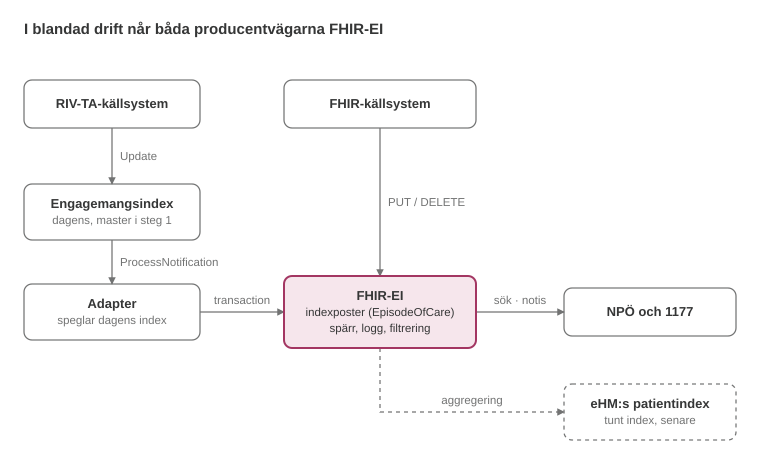

# FHIR-baserad engagemangsindexkomponent – utkast till spec

2026-10-26 · Oskar Thunman

> Arbetsunderlaget som implementationsguiden i detta repo bygger på. Specen beskriver designen och dess skäl; IG:n under `input/` är den formella realiseringen. Där IG:n gör val som specen lämnar öppna, eller uttrycker något annorlunda för att det ska fungera i FHIR, står det på IG-sidan *Mappning till profiler* (`input/pagecontent/mappings.md`). Ändringar i designen görs här först och förs sedan in i IG:n.

## Syfte och avgränsning

Specen beskriver en ny EI-komponent för FHIR (arbetsnamn FHIR-EI). Komponenten svarar på tre frågor: i vilka system finns information om en patient, vilka informationsmängder finns där, och när uppdaterades de senast. Den ersätter engagemangsindex när NPÖ och 1177 FHIR-ifieras, och följer samma mönster som NHS Englands National Record Locator.

Specen omfattar:

- informationsmodell för indexposten
- kodverk för informationsmängder
- API för sökning, registrering och prenumeration
- händelsemodell och leveransgarantier, inklusive övergången från dagens engagemangsindex
- spärr, loggning och filtrering av svar
- samexistens med eHM:s patientindex: borttag, grundladdning och återsynk

Utanför specen ligger allt som rör hämtning av journalinformation: realtidshämtning, pre-warm, cachning och central lagring. Komponenten pekar ut var information finns. Den lagrar eller förmedlar inte journalinnehåll.

Första konsumenter är NPÖ och 1177.

## Begrepp och arkitekturprinciper

Komponenten är ett rikt index av pekare. Den ska klara minst det dagens engagemangsindex klarar och vara byggd så att ett tunt index hos eHM kan härledas ur den senare.

| Begrepp | Betydelse |
|---|---|
| Indexpost | En pekare: patient × endpoint × tjänst, med de informationsmängder som finns och tidpunkt för senaste innehåll |
| Tjänst | En IG; motsvarar tjänstedomän i dagens modell |
| Informationsmängd | En profil eller resurs inom en tjänst; motsvarar kategori i dagens modell |
| Tillämpning | En tjänsts profil av den gemensamma indexprofilen, som bestämmer vad indexet svarar på för just den tjänsten |
| Endpoint | Producentens åtkomstpunkt, registrerad i tjänstekatalogen |
| Logisk adress | Adressen en RIV-TA-konsument anger mot tjänsteplattformen. I tjänstekatalogen är den en organisations HSA-id, inte en egen endpoint |
| Producent | System som registrerar, uppdaterar och avregistrerar indexposter (källsystemet eller övergångsadaptern). Identifieras med sin endpoint i tjänstekatalogen |
| Konsument | Tjänst som söker i eller prenumererar på indexet, till exempel NPÖ och 1177 |
| Tunt index | eHM:s patientindex kopplat till NDI |

Principer:

1. Pekare, inte innehåll. Indexet svarar på var och när, aldrig vad.
2. Minst lika god förmåga som idag. Det gäller aktualitet, leveransgarantier, borttag och återhämtning.
3. Registrera en gång. Indexposten ska bära det som behövs för att härleda ett tunt index, även om Inera inte tar det ansvaret i första iterationen.
4. Övergång utan krav på producenterna. Befintliga uppdateringar till engagemangsindex mappas in, så att källsystem kan gå över till FHIR i egen takt.
5. Indexet är självt skyddsvärd information. Att en patient har en post hos en viss vårdenhet är en uppgift om patienten. Komponenten tillämpar därför spärr, loggning och filtrering.
6. Profilering enligt Ineras tre-lagersmodell, ovanpå svenska basprofiler.

## Informationsmodell: indexposten som pekare

Indexposten är en pekare: den anger att en producent, via en endpoint, har information om en patient inom en tjänst. Posten definieras i en gemensam logisk modell och representeras i FHIR R5 som en profilerad `DocumentReference`. Det är samma mönster som NHS NRL och IHE MHD. I R5 har DocumentReference breddats till att referera innehåll av alla slag, inte bara dokument.

Tre begrepp hålls isär:

- **Vårdepisod.** Klinisk information hos producenten. Ingår inte i indexet.
- **Indexpost.** Uppgiften att information finns tillgänglig hos en producent. Representeras med indexprofilen.
- **Innehåll.** Själva journalinformationen. Hämtas från producentens endpoint efter att indexet pekat ut den.

### Granularitet

En post per patient × endpoint × tjänst. En tjänst är en IG och motsvarar tjänstedomän i dagens modell. En post kan bära flera informationsmängder. Tidpunkten för senaste ändring gäller hela posten. En informationsmängd som behöver en egen tidpunkt bryts ut till en egen tjänst.

### Gemensam modell, tillämpning per tjänst

Vad indexet svarar på bestäms per tjänst: bara var det finns information, eller också vilka informationsmängder som finns och hur aktuella de är. Varje tjänst publicerar sin tillämpning som en profil av den gemensamma indexprofilen, i tjänstens IG. Därmed hålls semantiken ihop även när tjänsterna använder indexet olika.

| Element | Gemensam modell | Tillämpningen per tjänst bestämmer |
|---|---|---|
| Patient, tjänst, endpoint, producent, vårdgivare | Obligatoriska | Inget |
| Informationsmängder | 0..* | Om de anges, och vilka värden som är tillåtna |
| Innehållets senaste ändring | 0..1 | Om den är obligatorisk, och vad som räknas som ändring |
| Status och livscykel | Obligatoriska | Inget |

### Logisk modell och FHIR-representation

| Element | FHIR R5 DocumentReference | Dagens engagemangsindex |
|---|---|---|
| Identitet | `identifier`, stabil och producentbunden: `system` = producentens endpoint-URL i tjänstekatalogen (se nedan), `value` = producentens id för posten | businessObjectInstanceIdentifier |
| Patient | `subject` → Patient med identifier (personnummer, samordningsnummer) | registeredResidentIdentification |
| Tjänst | `type`: tjänstedomän under övergången, IG:ns canonical därefter | serviceDomain |
| Informationsmängder | `content.profile`: dagens kategori som Coding, profilens canonical därefter | categorization |
| Endpoint | extension `sourceEndpoint` → Endpoint i tjänstekatalogen, en per post; `content.attachment.url` = endpointens adress | logicalAddress, via adapterns adressregister |
| Logisk adress | extension `logicalAddress` (HSA-id), när endpointen adresseras med logisk adress | logicalAddress |
| Källsystem | extension `sourceSystem` (HSA-id, 0..*), satt av övergångsadaptern | sourceSystem |
| Vårdgivare | `custodian` | dataController |
| Vårdenhet | extension `careUnit` (HSA-id) | careUnitId |
| Registrerande producent | extension `registeringProducer` → producentens Endpoint i tjänstekatalogen (absolut referens); kontrolleras av FHIR-EI mot autentiserad klient | owner |
| Innehållets senaste ändring | extension `contentLastUpdated` (dateTime) | mostRecentContent |
| Postens senaste ändring | `meta.lastUpdated`, `_history` | updateTime, creationTime |
| Status | `status` + extensions registrationStatus och `deregistrationReason` | deleteFlag |

`meta.source` används bara för spårbarhet. Konsumenter känner igen indexposter på `meta.profile`.

### Producent, endpoint och logisk adress

Producentens identitet är dess endpoint i tjänstekatalogen. FHIR-EI binder den autentiserade klienten till en Endpoint där, och `registeringProducer` är en absolut referens till den. Samma URL är producentens namnrymd i `identifier.system`, så FHIR-EI kan kontrollera namnrymden utan ett eget register.

| Producent | registeringProducer | sourceEndpoint | logicalAddress |
|---|---|---|---|
| Direktansluten FHIR-producent | Producentens endpoint | Samma endpoint | Utelämnas |
| Övergångsadaptern | Adapterns egen endpoint | Endpoint enligt adapterns adressregister, t.ex. tjänsteplattformens endpoint för tjänstekontraktet | Logisk adress från dagens engagemangsindex |

I tjänstekatalogen är den logiska adressen en organisations HSA-id, och organisationen listar sina endpoints. En endpoint kan delas av många logiska adresser, till exempel tjänsteplattformens adress för ett tjänstekontrakt. Posten bär därför den logiska adressen separat när endpointen adresseras med logisk adress. Poster från adaptern bär också källsystemet, eftersom registrerande producent då är adaptern.

HSA-id anges med systemet `urn:oid:1.2.752.29.4.19`, som i HL7 Swedens basprofiler och tjänstekatalogen. FHIR-EI tar även emot RIV-TA:s `urn:oid:1.2.752.129.2.1.4.1` för samma identifierarrymd och lagrar värdet med basprofilernas system.

### Tidpunkter

- `contentLastUpdated`: när det kliniska innehållet i källsystemet senast ändrades, enligt producenten.
- `meta.lastUpdated`: när indexposten senast ändrades i FHIR-EI. Sätts av servern.
- Mottagningstid: när FHIR-EI senast tog emot en rapport om posten. Loggas för drift och avstämning, inte sökbar.

En uppdatering av posten ändrar inte `contentLastUpdated` om innehållet är oförändrat.

### Livscykel

| Logiskt tillstånd | R5 `status` (basvärde) | Extension `registrationStatus` | Synlig i standardsökning |
|---|---|---|---|
| Registrerad: informationen finns tillgänglig | `current` | `active` | Ja |
| Indragen: producenten har dragit tillbaka posten (avslutat engagemang, gallring) | `superseded` | `withdrawn` | Nej; syns vid explicit statusfilter, ändringssökning och export |
| Felregistrerad: posten skulle aldrig ha funnits | `entered-in-error` | `entered-in-error` | Som indragen |

`DocumentReference.status` har en obligatorisk bindning till `current | superseded | entered-in-error` och kan inte utökas med egna koder. Den exakta semantiken bärs därför av extensionen `registrationStatus`. En generisk FHIR-konsument som inte förstår extensionen ser ändå på basvärdet att posten inte längre är aktuell. `withdrawn` är valt framför `unavailable`, eftersom det uttrycker en avsiktlig och bestående handling av producenten. `unavailable` kan läsas som ett tillfälligt driftavbrott, och det ska indexet inte uttrycka. Orsaken anges i `deregistrationReason`. En indragen post ligger kvar som gravsten under gravstenarnas lagringstid och rensas sedan fysiskt.

Skiss i FSH:

```fsh
Profile: IneraIndexEntry
Parent: DocumentReference  // FHIR R5
Id: inera-index-entry
Title: "Indexpost (FHIR-EI)"
Description: "Gemensam indexpost. Anger att en producent via en endpoint har information om en patient inom en tjänst."
* identifier 1..* MS  // system = producentens endpoint-URL
* status MS  // basvärde: current | superseded | entered-in-error
* type 1..1 MS  // tjänst (IG)
* subject 1..1 MS
* subject only Reference(Patient)
* subject.identifier 1..1
* custodian 1..1 MS
* content 1..1 MS
* content.attachment.url 1..1 MS
* content.profile MS  // informationsmängder; kardinalitet sätts per tjänst
* extension contains
    SourceEndpoint named sourceEndpoint 1..1 MS and
    CareUnit named careUnit 1..1 MS and
    RegisteringProducer named registeringProducer 1..1 MS and  // Reference(Endpoint) i tjänstekatalogen
    LogicalAddress named logicalAddress 0..1 MS and            // när endpointen adresseras med logisk adress
    SourceSystem named sourceSystem 0..* MS and                // satt av övergångsadaptern
    ContentLastUpdated named contentLastUpdated 0..1 MS and
    RegistrationStatus named registrationStatus 1..1 MS and
    DeregistrationReason named deregistrationReason 0..1 MS
* obeys inv-status-map          // active ↔ current, withdrawn ↔ superseded, entered-in-error ↔ entered-in-error
* obeys inv-deregistration      // deregistrationReason finns om och endast om registrationStatus != active
* obeys inv-producer-namespace  // identifier.system = registeringProducer

CodeSystem: IndexRegistrationStatus
Id: index-registration-status
* #active "Registrerad" "Informationen finns tillgänglig hos producenten."
* #withdrawn "Indragen" "Producenten har avsiktligt och varaktigt dragit tillbaka posten."
* #entered-in-error "Felregistrerad" "Posten skulle aldrig ha funnits."

// Tillämpning per tjänst, publiceras i tjänstens IG
Profile: LakemedelIndexEntry
Parent: IneraIndexEntry
* type = <tjänstens IG-canonical>
* content.profile 1..*
* extension[contentLastUpdated] 1..1
```

## Kodverk för tjänster och informationsmängder

Tjänst och informationsmängd är två nivåer i samma hierarki: en tjänst är en IG, och en informationsmängd är en profil eller resurs inom den. Indexet börjar med dagens tjänstedomäner och kategorier och går över till IG-canonicals och profil-canonicals. Under övergången får en post bära både gammal och ny kodning, så att konsumenter som bara förstår tjänstedomän fungerar hela vägen.

| Nivå | Idag | Framåt | Representation |
|---|---|---|---|
| Tjänst | Tjänstedomän, t.ex. `riv:clinicalprocess:healthcond:description` | IG:ns canonical | `type.coding`, en kodning per generation |
| Informationsmängd | Kategori inom domänen, t.ex. `voo` | Profilens canonical, eller resurstyp | `content.profile` som Coding (idag) eller canonical (framåt) |

Regel för uppdelning: en informationsmängd som behöver en egen tidpunkt för senaste ändring bryts ut till en egen tjänst. Tjänstegränsen följer alltså behovet av aktualitetsinformation, inte bara den kliniska domänen.

En mappningstabell mellan tjänstedomän/kategori och IG/profil publiceras tillsammans med den gemensamma indexprofilen. Övergångsadaptern använder den för att fylla i de nya kodningarna på poster som bara kommer med tjänstedomän.

## API: sökning, registrering och prenumeration

Dagens tre tjänstekontrakt (FindContent, Update och ProcessNotification) får var sin FHIR R5-motsvarighet. API:et skiljer på tre användningsfall: sökning vid behov, löpande uppdatering via prenumeration och massuttag för avstämning. Alla läs-, skriv-, prenumerations- och exportanrop går genom samma centrala kontroll av behörighet, spärr och loggning, se avsnittet om spärr.

| Operation | Aktör | FHIR-interaktion | Motsvarighet idag |
|---|---|---|---|
| Sök indexposter för en patient | Konsument | `GET DocumentReference?patient.identifier=…&type=…` (standard: `status=current`) | FindContent |
| Filtrera på informationsmängd | Konsument | Standardparametrarna `format-code` / `format-canonical` (på `content.profile`) | FindContent med kategori |
| Filtrera på aktualitet | Konsument | Nationell sökparameter `content-last-updated=gt…` | FindContent med tidsfilter |
| Registrera eller uppdatera post | Producent | Villkorad `PUT DocumentReference?identifier=<producent>\|<id>`, eller `transaction`-Bundle för flera | Update |
| Avregistrera post | Producent | Villkorad `PUT` med `status` = `superseded` eller `entered-in-error` och `deregistrationReason` | Update med deleteFlag |
| Prenumerera på ändringar | Konsument | R5 `Subscription` på `SubscriptionTopic` `indexpost-andrad` | ProcessNotification |
| Inkrementell avstämning | Konsument | `GET DocumentReference?_lastUpdated=gt…&status=current,superseded,entered-in-error` | Saknas |
| Massuttag | Systemkonsument | Bulk Data `$export` med `_type=DocumentReference` och `_since` | Saknas |

Sökparametrar. Kedjad sökning på `patient.identifier` är obligatorisk för servern. `content-last-updated` och `source-endpoint` är nationella sökparametrar. De definieras som `SearchParameter`-resurser i IG:n och annonseras i FHIR-EI:s `CapabilityStatement`, tillsammans med vilka prenumerationsfilter som stöds.

Endpoint. Varje post har exakt en endpoint, som refereras i tjänstekatalogen. Katalogen är auktoritativ för endpointens egenskaper. Adressen finns också i `content.attachment.url`, så att konsumenten kan anropa källan utan ett extra uppslag.

Logisk adress. När endpointen adresseras med logisk adress, som tjänsteplattformen för RIV-TA, bär posten också `logicalAddress`, och konsumenten anger den i anropet. Den logiska adressen är en organisations HSA-id i tjänstekatalogen och kan slås upp där.

Villkorad uppdatering. Villkoret utvärderas bara mot anropande producents egna poster. En producent kan därför aldrig träffa en annan producents post, och svaret avslöjar inte om en identifierare finns hos någon annan:

| Träffar bland producentens egna poster | Resultat |
|---|---|
| 0 | Posten skapas |
| 1 | Posten uppdateras |
| Fler än 1 | Avvisas med `412 Precondition Failed`; ingen post ändras |

Samtidiga uppdateringar av samma post hanteras med versionsvillkor (`If-Match` på `ETag`) eller med regeln om `contentLastUpdated` i avsnittet om händelser. En producent får inte ändra `identifier` eller `registeringProducer` på en befintlig post.

Prenumeration. R5 har topic-baserade prenumerationer inbyggda, inklusive operationerna `$status` och `$events`. Topic `indexpost-andrad` triggar på skapande, uppdatering och avregistrering. Avregistrering syns som en uppdatering till status `superseded` eller `entered-in-error`, inte som en radering. Filter stöds på patient, `type` och `custodian`. Standardinnehåll är `id-only`, så att notisen inte bär mer patientinformation än nödvändigt.

Massuttag kompletterar men ersätter inte prenumeration. Bulk Data är asynkront och inte avsett för realtidsutbyte. Ett `_since`-uttag innehåller även avregistrerade poster inom lagringstiden, så att en konsument kan upptäcka borttag utan att ha fått notisen.

Producentidentitet och skrivbehörighet. En producents identitet är dess Endpoint i tjänstekatalogen. FHIR-EI binder den autentiserade klienten till en sådan endpoint, via en betrodd koppling mellan klientidentitet (certifikat eller token) och endpoint. Vid varje skrivning kontrollerar FHIR-EI:

| Kontroll | Regel |
|---|---|
| Producent | `registeringProducer` är en absolut referens till den endpoint klienten är bunden till |
| Namnrymd | `identifier.system` är samma URL som `registeringProducer`. Kontrollen är en strängjämförelse och kräver inget register över namnrymder |
| Endpoint | För en direktansluten producent är `sourceEndpoint` samma endpoint som `registeringProducer` |
| Vårdgivare | Vårdgivaren i `custodian`, eller en underliggande enhet via `partOf`, listar `sourceEndpoint` i `Organization.endpoint` i tjänstekatalogen |

Övergångsadaptern har en ombudsroll. Den är registrerad i tjänstekatalogen med en egen endpoint och får registrera poster vars `sourceEndpoint` är en annan endpoint, men bara för kombinationer av logisk adress och tjänstedomän som finns i dess adressregister. `meta.source` används aldrig ensamt för behörighetskontroll.

## Registrering, händelsemodell och övergång

Leveransgarantin är minst den samma som idag: en ändring i källsystemet ska nå indexet utan förlust, i rätt ordning per post, och kunna återhämtas efter avbrott. Det gäller både dagens RIV-TA-producenter och framtida FHIR-producenter.

Krav på registreringen, från producent till FHIR-EI:

- **Idempotens.** Uppdatering och avregistrering sker villkorat på producentbunden `identifier`. Samma händelse två gånger ger samma resultat.
- **Ordning per post.** En uppdatering med äldre `contentLastUpdated` än den lagrade ignoreras, så att sena eller omkastade händelser inte skriver över nyare. En avregistrering kan bara upphävas av en ny registrering med senare `contentLastUpdated`.
- **Minst en leverans.** Producent eller adapter försöker igen tills FHIR-EI kvitterat. Ej levererbara händelser hamnar i en kö för manuell hantering.
- **Atomicitet.** En `transaction`-Bundle registreras helt eller inte alls.

Krav på notiserna, från FHIR-EI till prenumerant. Principen är att prenumerationen ger snabbhet och avstämningen ger korrekthet. En konsument ska kunna återställa en korrekt bild även om den missat notiser.

| Fråga | Regel |
|---|---|
| Kan notiser komma flera gånger? | Ja. Varje notis bär ett löpande händelsenummer i `SubscriptionStatus`. Konsumenten deduplicerar på händelsenummer och postens `meta.versionId`. |
| Garanteras ordning? | Bara per post, via `meta.versionId`. Konsumenten ignorerar en notis om en äldre version än den den redan har. Ingen ordning garanteras mellan poster. |
| Hur upptäcks missade notiser? | Luckor i händelsenumren, uteblivna heartbeat-notiser eller fel vid anrop av `$status` på prenumerationen. |
| Hur återhämtar sig konsumenten? | Kortare avbrott: `$events` för att hämta missade händelser ur händelseloggen. Längre avbrott: inkrementell avstämning med `_lastUpdated` inklusive avregistrerade poster. Avbrott längre än gravstenarnas lagringstid, eller ny konsument: `$export` och full omladdning. |
| Hur syns borttag? | Som uppdatering till status `superseded` eller `entered-in-error`. Gravstenen finns kvar under lagringstiden, så borttaget syns även vid avstämning. |

Två lagringstider ska fastställas. Båda härleds från samma fråga: hur långt avbrott ska en konsument klara utan full omladdning?

| Lagringstid | Vad den styr | Dimensioneras efter |
|---|---|---|
| Händelselogg | Hur långt bakåt en konsument kan hämta missade notiser med `$events` | Normala driftavbrott hos konsumenter; kort, eftersom avstämning tar vid efteråt |
| Gravstenar | Hur länge en avregistrerad post syns vid inkrementell avstämning och `_since`-export | Det längsta tillåtna avbrottet för alla synkande konsumenter, inklusive en framtida synk mot eHM |

Övergången sker i tre steg:

1. **Spegling.** Dagens engagemangsindex är fortsatt master. En adapter prenumererar på det via ProcessNotification och skriver motsvarande indexposter i FHIR-EI. Grundladdning sker med ett engångsuttag. Inga producenter behöver ändras.
2. **Blandad drift.** Källsystem som kan FHIR registrerar direkt i FHIR-EI. Adaptern fortsätter för övriga. Adaptern måste skriva tillbaka FHIR-registrerade poster till dagens engagemangsindex så länge konsumenter läser därifrån.
3. **Byte av master.** När NPÖ och 1177 läser från FHIR-EI blir det master. Dagens engagemangsindex kan då speglas från FHIR-EI eller avvecklas.



RIV-TA-producenter når FHIR-EI via dagens index och adaptern; FHIR-producenter skriver direkt. Synken till eHM är streckad eftersom den inte ingår i första iterationen.

Ansvar under övergången. Adaptern speglar dagens engagemangsindex utan egen affärslogik. Ansvaret för att indexposterna är korrekta ligger därför kvar hos producenterna, genom deras registrering i dagens engagemangsindex.

Mappning av Update till FHIR: engagemangsposter för samma patient, logiska adress och tjänstedomän slås ihop till en indexpost, med dagens kategorier som informationsmängder. Varje post blir en villkorad `PUT` i en `transaction`, med fältmappningen i avsnittet om informationsmodell. `contentLastUpdated` sätts till den senaste mostRecentContent bland de ingående engagemangsposterna. deleteFlag på den sista ingående engagemangsposten mappas till avregistrering med status `supersed``ed`. Dagens kontrakt bär ingen orsak, så adaptern sätter `deregistrationReason` till en kod för avregistrering via övergångsadapter.

Adaptern sätter `logicalAddress` och `sourceSystem` från engagemangsposterna, och `registeringProducer` till sin egen endpoint. Postens `identifier.system` blir därmed adapterns endpoint-URL, och värdet bildas deterministiskt ur patient, logisk adress och tjänstedomän.

Adressregister i adaptern. Tjänstekatalogen har ingen endpoint per logisk adress, och den har inte TAK:s uppgift om vilken logisk adress och vilket tjänstekontrakt som routas till vilken producent. Adaptern håller därför ett eget adressregister, byggt genom att samköra TAK med tjänstekatalogen. Nyckeln är logisk adress och tjänstedomän, och värdet är den endpoint i tjänstekatalogen som posten ska peka på. Samma tänk finns i EHDS-bryggan, som håller ett eget register från vårdgivare till endpoint. Två varianter är möjliga för värdet:

1. Tjänsteplattformens endpoint för tjänstekontraktet. Konsumenten anropar tjänsteplattformen med RIV-TA och anger postens `logicalAddress`.
2. EHDS-bryggans FHIR-yta för vårdgivaren (`/fhir/{vg-hsa-id}/`). Konsumenten hämtar med FHIR, och bryggan översätter till RIV-TA. Bryggan använder vårdgivarens HSA-id som logisk adress, medan dagens engagemangsposter kan ha vårdenhetens eller källsystemets, så det måste stämmas av mot TAK.

Överlämning från adaptern. När ett källsystem börjar registrera direkt i FHIR-EI får dess poster en ny endpoint, och därmed nya poster, eftersom en post gäller patient × endpoint × tjänst. Adaptern avregistrerar då sina poster för källsystemet med orsaken avregistrering via övergångsadapter. Prenumeranter ser en avregistrering och en ny registrering för samma information.

## Spärr, loggning och filtrering

Initial hypotes: FHIR-EI är sin egen åtkomstkontrollpunkt. Komponenten anropar spärrtjänsten, loggar i loggtjänsten och filtrerar svaren innan de lämnas ut, på samma sätt som EHDS-bryggan. Konsumenterna får alltså bara se poster de har rätt att se.

| Funktion | Vad komponenten gör | Beroende |
|---|---|---|
| Åtkomstkontext | Kräver i varje anrop vem som frågar (HSA-id eller invånare), för vilken vårdgivare och vårdenhet, i vilket uppdrag, med vilket syfte (`purposeOfUse`), samt samtycke eller nödåtkomst där det krävs | Säkerhetstjänst, token med kontextanspråk |
| Spärrkontroll | Frågar spärrtjänsten med åtkomstkontexten och tar bort poster som omfattas av spärr | Spärrtjänsten, på sikt en FHIR-baserad spärrtjänst |
| Filtrering | Tar bort poster utanför frågande aktörs behörighet. Om konsumenten får veta att poster filtrerats (till exempel "information finns men kräver samtycke") beror på lagstiftningen för syftet. Det styrs av `purposeOfUse` i frågan och av spärrtjänstens svar, som FHIR-EI för vidare i sitt svar | Spärrtjänsten, policy per konsument (NPÖ, 1177) |
| Ombud | För 1177: tillämpar fullmakt när någon söker för en annan person | Fullmaktsarkitekturen |
| Loggning | Loggar både varje sökning och varje utlämnad post som åtkomst till patientuppgift | Loggtjänsten |

Prenumerationer filtreras på samma sätt. En konsument får bara notis om poster den skulle ha fått i en sökning. Det, och `id-only`-innehåll, hindrar att notiser läcker förekomst av spärrad information.

Kontrollen gäller alla operationer: sökning, läsning, skrivning, prenumeration, inkrementell avstämning och export. Filtreringen sker i FHIR-EI innan svaret lämnas ut, aldrig bara i den komponent som presenterar svaret. Producenternas skrivningar filtreras inte men auktoriseras mot den autentiserade producentidentiteten, se API-avsnittet. Export kräver egen behörighet för systemkonsumenten och loggas per uttag.

Granularitet: spärrar gäller idag på vårdgivar- och vårdenhetsnivå. Med indexposter per tjänst går det längre fram att spärra eller filtrera per tjänst utan ändrad modell.

## Samexistens med eHM:s patientindex

FHIR-EI och eHM:s patientindex samexisterar. Inera tar inte ansvar för vårdgivarnas registrering i eHM:s index i första iterationen. Komponenten ska ändå klara de tre fall som en senare synk på vårdgivarnas vägnar förutsätter, med borttag som det viktigaste.

| Fall | Krav på FHIR-EI | FHIR-mekanism |
|---|---|---|
| Borttag | Varje borttag är en avregistrering som går att följa, med orsak: felregistrering, avslutat engagemang, gallring. Gravstenen behålls under gravstenarnas lagringstid. | Status `superseded` / `entered-in-error` + `deregistrationReason`; notis som uppdatering; syns i `_lastUpdated`-sökning och `_since`-export |
| Grundladdning | FHIR-EI laddas initialt från dagens engagemangsindex. Senare ska ett tunt index kunna laddas från FHIR-EI. | Engångsuttag via adaptern; Bulk Data `$export` med `_type=DocumentReference` |
| Återsynk | Avvikelser efter avbrott hittas och rättas utan full omladdning, även för borttag som missats. | Inkrementell avstämning med `_lastUpdated` eller `$export` med `_since`, inklusive gravstenar; kontrollsummor eller antal per vårdgivare och dag |

Nästa steg är att torrsimma de tre fallen mot eHM:s API-specifikationer för patientindexet: nyckel, granularitet, API och semantik för borttag.

Att härleda det tunna indexet blir en aggregering: alla aktiva poster för samma patient och vårdgivare (eller vårdenhet) blir en post i eHM:s index. En avregistrering i FHIR-EI ska bara leda till borttag i det tunna indexet när den sista aktiva posten för den kombinationen avregistrerats. Exakt nyckel och granularitet beror på eHM:s krav, se öppna frågor.

## Öppna frågor

- [ ] Federation: dagens engagemangsindex kan vara hierarkiskt, där regionala index vidarebefordrar till det nationella via ProcessNotification. Ska FHIR-EI stödja en sådan topologi, eller bara ett nationellt index? (Den här frågan ersätter den tidigare om aggregering. Den andra tolkningen, att producenter registrerar en post per domän i stället för per journalobjekt, är besvarad av granularitetsbeslutet.)
- [ ] Latens: vilket krav gäller från ändring i källsystemet till synlig indexpost? Vad klarar dagens engagemangsindex i praktiken?
- [ ] Lagringstider: hur långt avbrott ska en konsument klara utan full omladdning? Svaret sätter både händelseloggens och gravstenarnas lagringstid.
- [ ] eHM:s tunna index: torrsimma borttag, grundladdning och återsynk mot eHM:s API-specifikationer.
- [ ] R5-beroende: tidplanen för svenska basprofiler i R5, och om konsumenter och producenter är redo för R5.
- [ ] Koppling mellan klient och endpoint: hur binds ett klientcertifikat eller en token till en endpoint i tjänstekatalogen? Tjänstekatalogens Endpoint har i dag ingen identifierare för det producerande systemet, så kopplingen kräver antingen en sådan där eller ett register i FHIR-EI.
- [ ] Adressregistret: ska adaptern peka på tjänsteplattformens endpoint per tjänstekontrakt eller på EHDS-bryggans FHIR-yta per vårdgivare? Bryggan använder vårdgivarens HSA-id som logisk adress; dagens engagemangsposter kan ha vårdenhetens eller källsystemets.
- [ ] Överlämning från adaptern: räcker avregistrering och ny registrering när ett källsystem går över till FHIR, eller behövs en operation som flyttar ägarskapet?
- [ ] Behörighet per vårdgivare: regeln att en producent bara får registrera för vårdgivare som listar dess endpoint i tjänstekatalogen förutsätter att vårdgivarna håller sina listningar aktuella. Hur säkerställs det?
